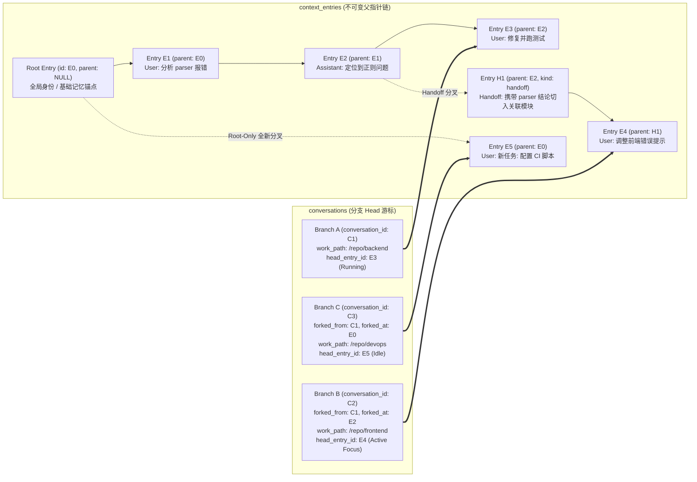
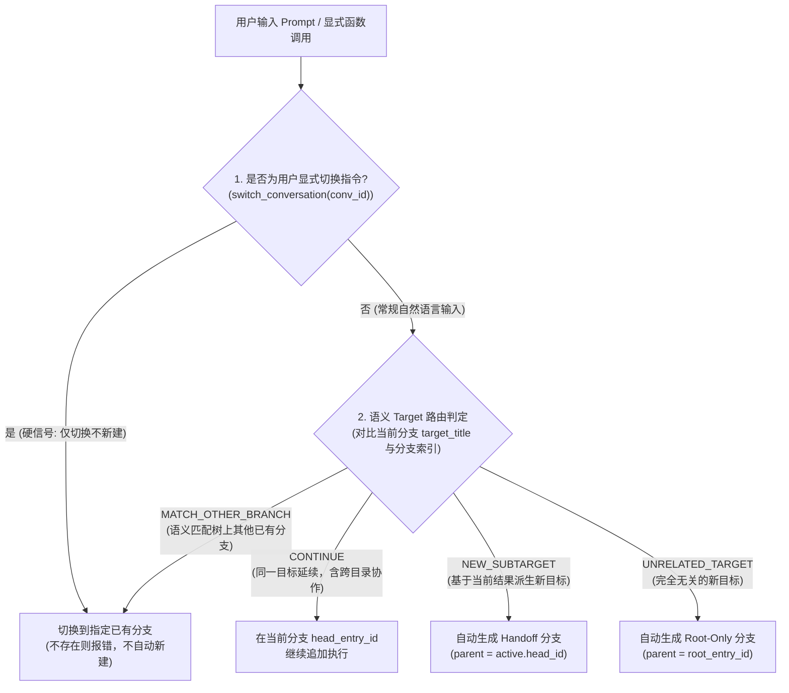
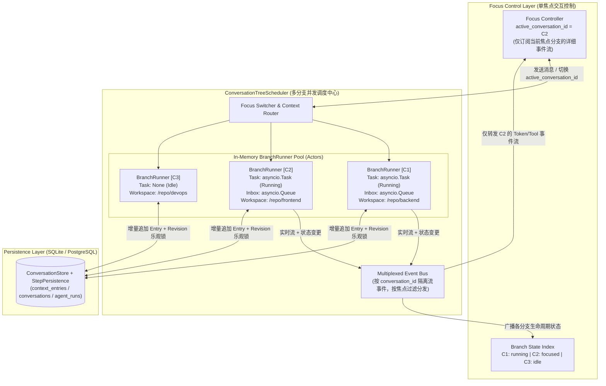

# 基于数据库链结构的 Context Tree（Conversation Tree）架构设计方案

本文分析如何用数据库中的父指针链结构替代传统“多条孤立会话（Flat Conversations）”的设计，实现从单一 Root Node 生长、随 Workspace 切换或新 Target 提出而自动派生分支、支持多分支后台异步并发执行且支持随时切换交互焦点的 **Context Tree（Conversation Tree）**。

> [!NOTE]
> **术语来源说明**
> 本方案严格沿用 Pydantic AI 的核心会话与运行术语，不另设 `turn_id` 别名或独立 ID 体系：
> - **`conversation_id`**（会话/分支标识）：对应 Pydantic AI 中 `Conversation.conversation_id`，用于标识一条逻辑对话分支并作为持久化与并发调度的主键（详见 [Pydantic AI Message History 官方文档](https://ai.pydantic.dev/message-history/)）。
> - **`run_id`**（单次 Agent 运行标识）：对应 Pydantic AI 中 `RunContext.run_id`，用于标识一次 `agent.run()` 调用过程，配合工具调用账本与执行快照实现中断恢复（详见 [Pydantic AI Agents 官方文档](https://ai.pydantic.dev/agents/)）。

当前框架依赖的 Pydantic AI 已在 `pydantic_ai.conversation_store` 中内置了 `ConversationEntry`（父指针消息节点）与 `ConversationRecord`（分支游标记录）原语。在此链式模型基础上扩展，即可构建完整的 Context Tree 持久化与多分支并发运行架构。

---

## 一、 核心数据结构：如何用数据库链结构表示 Context Tree

传统的会话设计将“会话（Conversation）”与“消息列表（Messages）”绑定为一对一的线性数组；而在 **Context Tree** 中，必须将**“不可变的消息节点链（Tree Nodes）”**与**“可移动的分支游标（Branch Heads / Conversations）”**彻底解耦：

1. **节点层（`context_entries`）—— 仅追加（Append-only）的反向单链表树**
   * 每个节点代表一次不可变的上下文增量（一条 `ModelMessage`、Root 锚点或 Handoff 交接摘要）。
   * 节点不存储“自己有哪些子节点”，只存储 **`parent_id`**（指向前驱节点）。当多个节点指向同一个 `parent_id` 时，天然在数据库中形成树状分叉（Branching），且**共享前缀历史实现零拷贝**。
2. **分支游标层（`conversations`）—— 指向树节点的 Head 指针**
   * 树上的**每一个分支就是一个独立的 `conversation_id`**（对应一个 Pydantic AI `Conversation` 对象）。
   * 分支记录不冗余存储历史消息，只维护 **`head_entry_id`**（当前分支走到了哪个节点）以及 **`forked_from` / `forked_at`**（从哪个父分支的哪个节点派生而来）。



### 1. 数据库表结构设计（SQLite / PostgreSQL 通用）

建议设计 3 张核心表，对齐 Pydantic AI 的 `ConversationStore` 抽象接口与 `pydantic_ai_harness.step_persistence.StepPersistence` 运行态恢复机制：

#### 表 1：`context_entries`（上下文树节点表 —— 树的骨架）

| 字段名 | 类型 | 说明 |
| :--- | :--- | :--- |
| `id` | `TEXT (PK)` | 节点唯一标识（使用按时间有序的 `UUIDv7`） |
| `tree_id` | `TEXT (INDEX)` | 所属 Context Tree ID（单用户全局一棵树时可固定为默认 Tree ID） |
| `parent_id` | `TEXT (FK, NULL)` | 指向父节点 `context_entries.id`；**仅 Root Node 为 `NULL`** |
| `kind` | `TEXT` | `'root'`（根节点）\| `'message'`（常规消息）\| `'handoff'`（分支交接摘要） |
| `stop_backtrack` | `BOOLEAN` | 回溯构建 LLM 上下文时是否在此截断（用于 `handoff` 节点隔离父分支冗长细节） |
| `message_json` | `JSONB / TEXT` | 使用 `ModelMessagesTypeAdapter` 序列化的单条 `ModelMessage` |
| `run_id` | `TEXT (NULL)` | 产生该节点的 Agent 运行 ID（对应 Pydantic AI `RunContext.run_id`） |
| `created_at` | `TIMESTAMP` | 节点创建时间 |

#### 表 2：`conversations`（分支游标表 —— 树的活跃枝条）

| 字段名 | 类型 | 说明 |
| :--- | :--- | :--- |
| `conversation_id` | `TEXT (PK)` | 分支唯一标识（即 Pydantic AI `Conversation.conversation_id`） |
| `tree_id` | `TEXT (INDEX)` | 所属 Context Tree ID |
| `head_entry_id` | `TEXT (FK)` | 当前分支最新节点指针，指向 `context_entries.id` |
| `forked_from` | `TEXT (FK, NULL)` | 父分支 `conversation_id`（Root 主干分支为 `NULL`） |
| `forked_at` | `TEXT (FK, NULL)` | 分叉点所在的 `context_entries.id` |
| `branch_mode` | `TEXT` | `'root'`（主干）\| `'root_only'`（仅含 Root 的新分支）\| `'handoff'`（交接派生分支）\| `'full_fork'`（全量历史派生） |
| `work_path` | `TEXT (NULL)` | 当前分支绑定的规范化 Workspace 路径 |
| `target_title` | `TEXT` | 当前分支的目标摘要（供自动路由和分支拓扑索引展示） |
| `status` | `TEXT` | `'idle'` \| `'running'` \| `'waiting_deferred'` \| `'failed'` \| `'interrupted'` |
| `usage_json` | `JSONB / TEXT` | 累计 Token 与工具调用统计（`RunUsage`） |
| `deferred_json` | `JSONB / TEXT` | 挂起等待外部回答的工具请求（`DeferredToolRequests`） |
| `revision` | `TEXT` | 乐观锁令牌（每次 `save` 更新 UUIDv7，防止并发写冲突 `ConversationConflict`） |
| `updated_at` | `TIMESTAMP` | 最后活跃时间 |

#### 表 3：`agent_runs`（单次运行与崩溃恢复快照表）

| 字段名 | 类型 | 说明 |
| :--- | :--- | :--- |
| `run_id` | `TEXT (PK)` | 单次运行标识（Pydantic AI `RunContext.run_id`） |
| `conversation_id` | `TEXT (FK)` | 所属分支 `conversation_id` |
| `base_entry_id` | `TEXT (FK)` | 本次运行启动时的分支 `head_entry_id` |
| `state` | `TEXT` | `'running'` \| `'complete'` \| `'interrupted'` \| `'failed'` |
| `frontier_messages_json` | `JSONB / TEXT` | 配合 `StepPersistence` 保存运行中途的 Frontier 快照；异常中断恢复时通过 `repair_messages` 将未完成工具调用标记为 `interrupted` |

### 2. 链式回溯查询：如何高效加载任意分支的 Context

当需要恢复或向某个分支 `conversation_id` 发送请求时，通过一条 **`WITH RECURSIVE` 递归公用表表达式（CTE）** 即可从 `head_entry_id` 顺着 `parent_id` 向上回溯到 `Root Entry`：

```sql
WITH RECURSIVE branch_chain AS (
    -- 1. 起点：当前分支的 head_entry_id
    SELECT id, parent_id, kind, stop_backtrack, message_json, 0 AS depth
    FROM context_entries
    WHERE id = (SELECT head_entry_id FROM conversations WHERE conversation_id = :conv_id)

    UNION ALL

    -- 2. 递归：沿 parent_id 向上回溯，直到 Root 或遇到截断型 handoff 节点
    SELECT e.id, e.parent_id, e.kind, e.stop_backtrack, e.message_json, bc.depth + 1
    FROM context_entries e
    JOIN branch_chain bc ON e.id = bc.parent_id
    WHERE bc.stop_backtrack = 0 OR e.kind = 'root'
)
SELECT id, kind, message_json
FROM branch_chain
ORDER BY depth DESC; -- 反转深度，得到从 Root 到 Head 的正序消息流
```

> [!TIP]
> **逻辑上下文与物理血缘分离**
> 通过 `stop_backtrack` 标记，**物理存储上**整棵树依然保持从 Root 到任意叶节点的完整血缘链（方便外部工具或观测层还原完整的分支拓扑），而**逻辑上下文（LLM Context）上**则能在 Handoff 节点处精准截断，避免父分支冗长的历史工具输出污染新分支的上下文窗口。

---

## 二、 分支自动生成与切换机制

### 1. 两种新分支生成模式的链式实现

在整棵树初始化时，首先插入一个 `Root Entry (id = E_root, parent_id = NULL, kind = 'root')`，承载全局系统设定或跨项目的用户级记忆锚点。当触发新分支创建时，存在以下两种生成路径：

#### 模式一：只包含 Root Node 的全新分支（`root_only`）

* **适用场景**：用户切换到了一个完全无关的 Workspace，或提出了一个与当前上下文毫无关联的全新 Target。
* **链操作**：
  1. 无需插入任何新 `context_entries`，直接复用 `E_root`。
  2. 在 `conversations` 表新建一条记录：
     * `conversation_id = new_uuid7()`
     * `forked_from = current_active_conversation_id`（保留是谁触发了这次分支跳转的血缘轨迹）
     * `forked_at = E_root.id`
     * `head_entry_id = E_root.id`
     * `branch_mode = 'root_only'`
  3. 用户的第一条新消息 `M1` 落盘时，其 `parent_id = E_root.id`，随后更新该分支的 `head_entry_id = M1.id`。

#### 模式二：Handoff Parent Node 的派生分支（`handoff` / `full_fork`）

* **适用场景**：
  * **轻量全量继承（`full_fork`）**：针对同一问题的不同探索方向。直接复用 `ConversationStore.fork(parent_conv_id)` 语义，新分支 `head_entry_id` 直接指向父分支当前的 `head_entry_id`，实现 O(1) 零拷贝分叉。
  * **摘要交接派生（`handoff`）**：用户切换到存在上下文关联的 Workspace（例如从后端 API 切换到前端调用），或从当前讨论中拆解出一个独立子目标。
* **Handoff 链操作**：
  1. 提取父分支 `C_parent` 截至当前节点 `E_parent_head` 的关键上下文摘要（由轻量模型快速生成结构化 Handoff Packet：包含**已确认结论、涉及的核心文件/接口约束、新分支的目标指令**）。
  2. 在 `context_entries` 中插入一个交接节点 `E_handoff`：
     * `parent_id = E_parent_head`（物理链挂在父分支当前位置之下，保持树状结构完整）
     * `kind = 'handoff'`
     * `stop_backtrack = True`（向上回溯时跳过父分支中间冗长的工具调用细节，只取 `E_root` + `E_handoff`）
     * `message_json` = 封装好的 Handoff 上下文说明消息
  3. 新建分支记录 `C_child`，其 `forked_from = C_parent.id`、`forked_at = E_parent_head`、`head_entry_id = E_handoff.id`。

### 2. 自动识别并触发新分支（Auto-Branching Pipeline）

在用户发出一条新指令时，先经过 **Context Router（上下文路由网关）**；**`set_workspace` 与分支切换/新建解耦**（在 Monorepo 中单任务经常跨目录协作，变更 `work_path` 仅更新当前会话激活目录并在请求末尾动态注入对应 `AGENTS.md`，不触发建枝或切枝）：



1. **硬信号触发（用户显式调用 `switch_conversation`）**：
   * 当用户明确指定切换分支（代码中体现为直接调用 `switch_conversation(conversation_id)`）时，直接切换到对应的已有 `conversation_id`（**仅切换不新建**，目标不存在时抛出 `LookupError`）。`set_workspace` 只改变当前会话的激活目录，不绑定分支切换。
2. **软信号触发（Target 语义偏移检测）**：
   * 维护树上所有活跃分支的轻量索引清单：`[{conversation_id, target_title, work_path, status}]`。
   * 使用低延迟的轻量模型进行结构化意图分类（Structured Output）：输入「当前分支 `target_title` + 最近若干轮摘要 + 其他活跃分支索引 + 用户新输入」，输出路由动作：`CONTINUE` | `SWITCH(conversation_id)` | `FORK_HANDOFF(new_title)` | `FORK_ROOT(new_title)`。

---

## 三、 多分支异步并发与“单焦点切换”实现方案

> [!NOTE]
> **实现收敛说明**
> 本节阐述的 `BranchRunner` / `ConversationTreeScheduler` 为早期多分支 Actor 池概念设计。实际代码已按 [Super-Agent 架构设计](./1117-super-agent.md) 收敛落地为更轻量的 **“单前台 `SuperAgentRouter` + 后台异步 `RoleSessionManager` & `WorkspaceLockManager` 读写锁调度”**；`full_fork` 跨分支迁移任务子链与 `waiting_deferred` 审批挂起态作为后续按需扩展项，当前未额外引入。

为了支撑“同时推进多个后台分支任务、但某一时刻交互焦点始终只停留在单一分支上，且可随时切换过去补充或继续”的运行模式，核心在于将**活跃焦点指针（Active Focus Pointer）**与**分支运行生命周期（Branch Execution Actor）**解耦。



### 1. `BranchRunner`（基于 Actor 模型的单分支运行器）

在核心调度层维护一个常驻的 `ConversationTreeScheduler`，内部管理映射表 `dict[conversation_id, BranchRunner]`。每个 `BranchRunner` 封装单个分支的独立执行上下文：

* **独立事件循环任务**：持有 `current_task: asyncio.Task | None`（对应当前正在执行的 `agent.run(..., conversation=conv)`，拥有独立的 `run_id`）。
* **独立工作区隔离**：启动运行时，通过 Pydantic AI 的 `workspace=LocalWorkspace(record.work_path)` 注入该分支专属的受限工作目录，确保多分支并发执行文件读写或命令时不会串目录。
* **独立缓冲与持久化断点**：
  * 每个运行中的 `BranchRunner` 维护当前 `run_id` 的实时输出缓冲（Live Stream Buffer）并挂载 `StepPersistence(capture_frontier=True)`。
  * 无论 `active_conversation_id` 当前是否指向该分支，后台任务都会正常推进并在每个工具节点完成后持久化快照；运行结束时调用 `ConversationStore.save(result)` 原子推进该分支的 `head_entry_id`。

### 2. 分支焦点切换（Active Branch Switching）流程

调度中心维护唯一的焦点指针 `active_conversation_id`。“切换对话对象”**绝不取消或阻塞后台正在运行的分支**，仅执行以下三步轻量化操作：

1. **退订旧焦点流**：解除事件总线对旧 `active_conversation_id` 详细输出事件（如模型生成文本增量与工具调用详情）的实时订阅（旧分支的 `asyncio.Task` 继续在后台静默运行）。
2. **更新指针并加载基线**：将 `active_conversation_id` 更新为目标分支 `C_target`，通过前述递归 CTE 查询 `C_target` 已持久化的 `context_entries` 历史链。
3. **拼接实时 Frontier 并订阅新流**：
   * 若 `C_target` 处于 `'idle'` 状态，直接输出已持久化的历史消息并等待下一条指令。
   * 若 `C_target` 处于 `'running'` 状态，将「已落盘的历史消息」与 `BranchRunner[C_target]` 内存中当前 `run_id` 尚未结束的「实时 Frontier 消息与流式缓冲」拼接还原为完整实时上下文，并立即开始接收后续的增量事件流。

### 3. 向任意分支随时“补充信息或继续”的并发控制

当用户切到某个分支（或显式指定某个 `conversation_id`）提交新消息时，根据目标分支 `BranchRunner` 的当前状态采用三种处理策略：

| 目标分支状态 | 调度处理机制 | 链结构与持久化表现 |
| :--- | :--- | :--- |
| **1. 空闲态 (`idle` / `completed`)** | 直接加载该分支的 `Conversation`（携带当前 `head_entry_id` 与 `revision`），启动新的 `asyncio.Task` 执行 `agent.run()`。 | 新消息以当前 `head_entry_id` 为 `parent_id` 顺延追加，并更新 `head_entry_id`。 |
| **2. 等待确认态 (`waiting_deferred`)** | 分支因工具审批或外部输入需求挂起在 `deferred_tool_requests`。将用户的补充回答通过 `build_results` 组装为 `deferred_tool_results` 传入下一次 `agent.run()`。 | 从挂起节点继续向下生长，恢复执行。 |
| **3. 运行态 (`running`) —— 中途插话或补充** | 提供两种可配置策略：<br/>**① 边界注入（Steer Queue，推荐）**：将补充消息推入该分支 `BranchRunner.inbox`。通过自定义 Capability 钩子在当前工具调用完成、准备发起下一轮模型请求前，将 `inbox` 中的补充消息作为新的 `ModelRequest` 动态注入上下文。<br/>**② 立即打断重开（Interrupt & Resume）**：取消当前 `asyncio.Task`，由 `StepPersistence` 捕获中断点并用 Pydantic AI 的 `repair_messages` 将未返回结果的工具调用标记为 `interrupted` 落盘推进 `head_entry_id`，随后立即携带用户的补充指令启动新的 `run_id`。 | **边界注入**在同一次 `run_id` 内连续生长；**打断重开**则将半截进度安全落盘在链上，紧接着以新的 `run_id` 向后追加节点，避免丢失已完成的工具成果。 |

### 4. 并发写安全与资源冲突防护

* **跨分支零行锁竞争**：`context_entries` 表采用纯粹的 **Append-Only（仅追加）** 写入方式，且每个分支在 `conversations` 表各自拥有独立的一行（以 `conversation_id` 为主键）。分支 A 与分支 B 同时在后台运行并保存各自的新节点时，修改的是不同的 `conversation_id` 记录，数据库层面不会产生交叉行锁冲突。
* **同分支乐观并发控制（OCC）**：直接复用 Pydantic AI `ConversationRecord.revision` 机制。每次 `write_record` 时校验 `WHERE conversation_id = :id AND revision = :expected_revision`；若因异常并发导致版本号不匹配，抛出 `ConversationConflict` 并基于最新 `head_entry_id` 重新加载合并，杜绝静默覆盖。
* **同一 Workspace 下的多分支文件冲突保护**：如果两个并发运行的分支恰好绑定了同一个 `work_path`：
  * 只读工具操作可安全并发共享；
  * 当检测到同一 `work_path` 下有第二个活跃分支尝试执行写文件或写盘命令时，可在 Workspace 能力层按需为新分支创建隔离的 **Git Worktree 目录**，或者通过路径级异步写入锁 / 变更冲突检测阻止两个分支同时覆盖同一份源码文件。

---

## 四、 方案总结

1. **持久层链式建模**：以 Pydantic AI 的 `ConversationStore`（`ConversationEntry.parent_id` + `ConversationRecord.head_id`）为内核，在数据库通过 **`context_entries`（不可变父指针节点表） + `conversations`（分支游标表） + `agent_runs`（运行恢复快照表）** 构建单根多叉上下文树。
2. **自动分叉与上下文隔离**：所有分支均从 `Root Entry` 生长；Workspace 切换或语义 Target 偏移时，通过**将新分支的初始 `head_entry_id` 指向 `Root Entry`（全新分支）或插入带 `stop_backtrack` 的 `Handoff Entry`（交接分支）**，在保持完整树状血缘的同时精准控制 LLM 上下文窗口。
3. **多分支异步并发与单焦点切换**：每个活跃 `conversation_id` 对应一个后台 `BranchRunner`（独立 `asyncio.Task` + 独立受限 `LocalWorkspace` + `StepPersistence` Frontier 快照），接入端只需通过切换 `active_conversation_id` 焦点指针订阅对应分支的事件流，实现“单焦点交互、多分支后台并行”。
