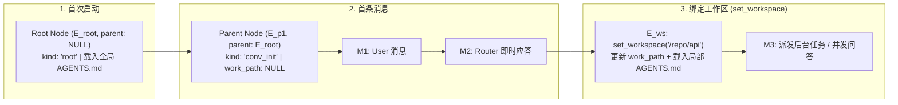
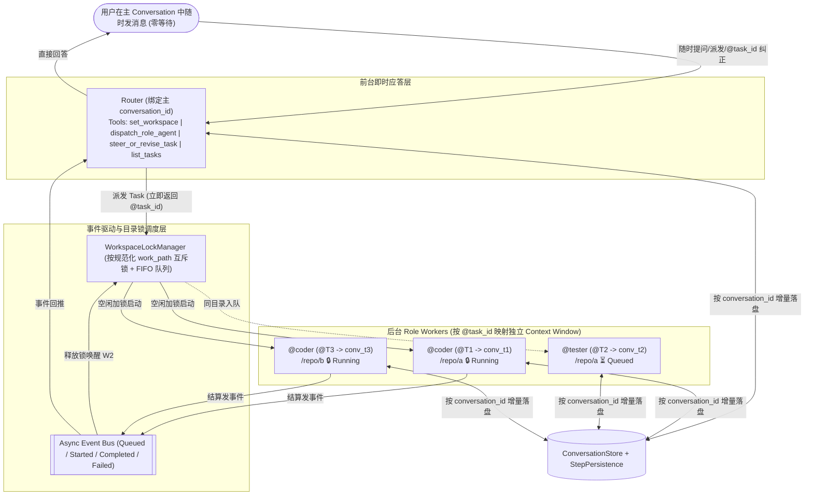
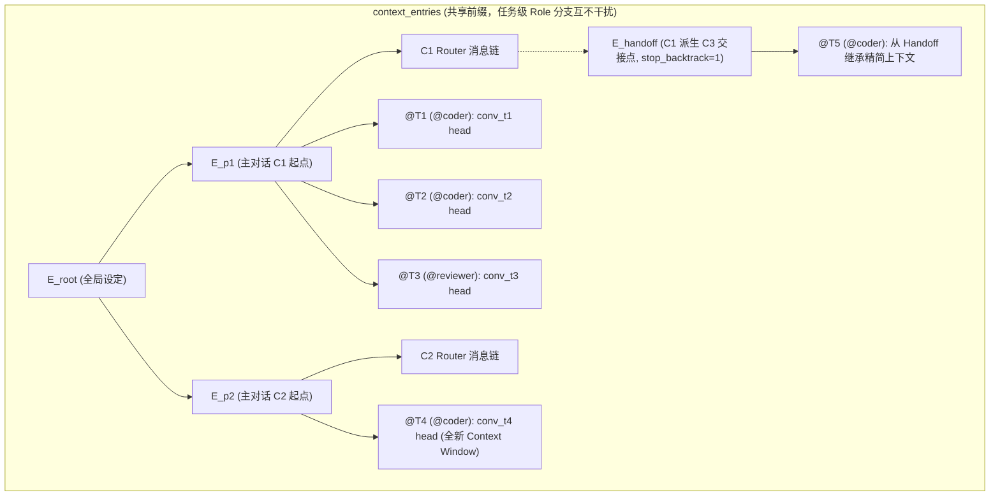
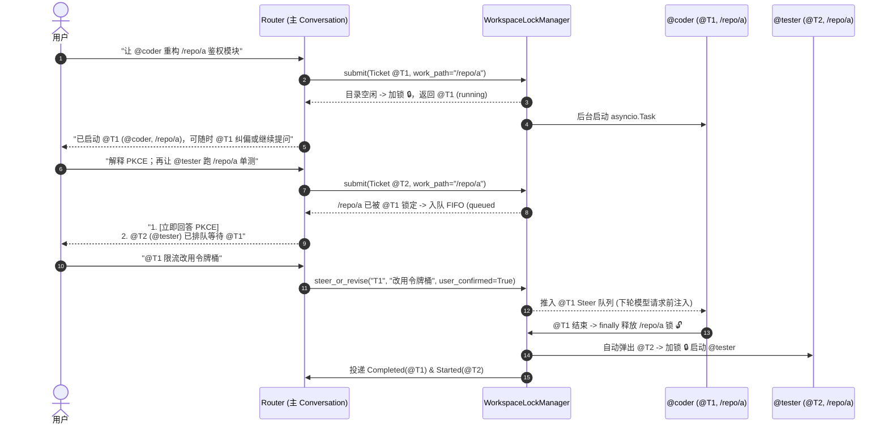

# 事件驱动 Super-Agent 架构设计：Router 管全局、有状态 Role Tool 管后台

本文在 [Context Tree 架构设计](./1117-conversation-tree.md) 的数据库父指针链基础上，参考 [deepseek-ai/dsh-superagent-prototype](https://github.com/deepseek-ai/dsh-superagent-prototype) 的 **Router–Worker 分离与事件驱动** 思想，细化从首次启动到重启恢复的上下文树生命周期，并给出 **Role Agent 作为有状态、持久化异步 Tool（随 `conversation_id` 切换 Context Window）** 及 **工作目录互斥锁与异步排队** 的完整实现方案。

> [!NOTE]
> **术语来源说明**
> 本方案严格沿用 Pydantic AI 的会话与运行术语，不另设 `turn_id` 或平行会话 ID 体系：
> - **`conversation_id`**：对应 Pydantic AI `Conversation.conversation_id`，用于标识一条逻辑上下文链（既包含用户与 Router 的主对话链，也包含每个 Role Agent 在该主对话下的专属子上下文链，详见 [Pydantic AI Message History 官方文档](https://ai.pydantic.dev/message-history/)）。
> - **`run_id`**：对应 Pydantic AI `RunContext.run_id`，用于标识单次 `agent.run()` 调用过程，配合 `StepPersistence` 实现断点与中断恢复（详见 [Pydantic AI Agents 官方文档](https://ai.pydantic.dev/agents/)）。

---

## 一、 Context Tree 启动、Workspace 动态绑定与重启恢复

在 [Context Tree 架构设计](./1117-conversation-tree.md) 定义的 `context_entries` 与 `conversations` 两张核心表之上，补充单行应用状态表 `app_state`（记录 `root_entry_id` 与 `last_active_conversation_id`），即可支撑完整的启动、动态绑定工作区与重启恢复生命周期。



1. **首次启动创建 `Root Node`（全局元祖节点）**：
   * 首次初始化数据库时，写入唯一元祖节点 `E_root`（`parent_id = NULL, kind = 'root'`），并将 `E_root.id` 写入 `app_state('root_entry_id')`。
   * **承载内容**：读取应用级全局设定（如全局 `AGENTS.md` 与跨会话通用准则），作为后续所有 `conversation_id` 的共同祖先节点。
2. **发送首条消息创建 `conversation parent_node`**：
   * 用户发送第一条消息时，首先在 `context_entries` 插入本会话的起始锚点 `parent_node`（`parent_id = E_root.id, kind = 'conv_init'`），并在 `conversations` 创建一条主会话记录（初始 `work_path = NULL`，支持无工作区的纯对话启动）。
   * 随后将该消息挂载到 `parent_node` 之后，更新 `conversations.head_entry_id` 与 `app_state('last_active_conversation_id')`。
3. **对话中通过 `set_workspace` Tool 动态绑定工作区（与分支切换解耦）**：
   * 当用户在对话中提及目录或明确要处理某个项目时，Router 调用 `set_workspace(path: str)`：
     * **路径规范化与校验**：将相对或软链路径解析为规范化绝对路径，校验目录存在且可读。
     * **原地更新、不触发切换或新建分支**：`set_workspace` 与 `switch_conversation` 解耦，始终原地更新当前 `conversation_id` 的 `work_path = norm_path`（适配 Monorepo 单任务跨目录协作）。
     * **规则末尾动态注入（不污染历史与前缀缓存）**：工作区局部 `AGENTS.md`（仅读取目标目录自身，不向上继承）**不写入持久化 `context_entries` 链**，而是在每次请求通过 `before_model_request` 动态注入到“前 N-1 轮历史之后、当前 `UserPrompt` 之前”的请求末尾，既彻底消除旧目录规则残留，又保护前序历史 Prefix Cache。
4. **重启应用自动恢复上次退出的 Conversation**：
   * 每次运行推进节点或中途退出前，持久化最新 `head_entry_id`、`app_state('last_active_conversation_id')` 及 `StepPersistence(capture_frontier=True)` 快照。
   * 下次启动时：读取 `last_active_conversation_id`，通过 `WITH RECURSIVE` CTE 沿 `parent_id` 从 `head_entry_id` 回溯至 `parent_node` 与 `E_root` 还原消息链，并加载绑定的 `work_path`。若上一次退出存在未返回结果的工具调用，使用 Pydantic AI 的 `repair_messages` 将其标记为 `interrupted` 落盘，随后即可无缝继续该 `conversation_id`（后台 `tickets` 任务的分类恢复与断点续跑详见 [重启恢复扩展设计](./1117-super-agent2.md)）。

---

## 二、 事件驱动架构：取消 Main/SubAgent 层级，统一为 Router + Role Agent Tools

为了在单个对话中实现**“派发后台任务后无需等待，用户可随时继续提问、纠正或再派发新任务”**，不再区分 Main Agent 与 SubAgent，系统只保留两类平等协作的组件：

1. **`Router`（全局协调者，绑定主 `conversation_id`）**：
   * 始终轻量化运行，**不直接执行耗时读写、测试或代码修改**。
   * 负责：① 即时回答用户问题（秒级返回）；② 调用 `set_workspace` 管理目录；③ 根据角色分工生成明确指令（Mandate）调用对应 **Role Agent Tool**；④ 接收后台完成/失败/提问事件并主动汇报或串联下一步审核。
2. **`Role Agents`（有状态、持久化的异步 Tool / Worker）**：
   * 所有专业角色（如 `@coder`、`@reviewer`、`@tester`、`@researcher`）地位平等，各自独立配置 `system_prompt`（`instructions`）、`model` 与专属工具集。
   * 对 Router 而言，每个 Role Agent 都是一个**异步 Tool**：调用后立即返回 Ticket 受理或排队回执（Receipt），后台 Worker 协程在受限工作区 `LocalWorkspaceBackend(work_path)` 中异步运行，完成后通过事件总线回推结果。



---

## 三、 Role Agent 持久化状态模型与 `@task_id` 靶向机制

如果 Role Agent 是无状态函数，就无法记住历史、接受持续纠正或跨 Agent 审核；而若同一 Role 在主对话内共享同一条上下文链，当 `@coder` 同时在后台挂载多个任务（异目录并行或同目录排队）时，不仅会发生并发写冲突，用户也无法精确指定要 Steer（运行中纠偏）或 Revise（结束后返工）哪一个任务。

### 1. 关键设计：每个 `(主 conversation_id, task_id)` 独占一条持久化子链

在 [1117-conversation-tree.md](./1117-conversation-tree.md) 的 `conversations` 表增加 `parent_conversation_id`、`role_name` 字段，并通过 `tickets` 表将外部可读的 **`task_id`**（如 `T1`、`T2`）与内部真实的 Role `conversation_id`（`role_conversation_id`）一一映射：

#### 扩展 `conversations` 表（统一管理主对话与各任务的 Role 上下文链）

| 字段名 | 类型 | 说明 |
| :--- | :--- | :--- |
| `conversation_id` | `TEXT (PK)` | Pydantic AI `Conversation.conversation_id` 主键 |
| `parent_conversation_id` | `TEXT (FK, NULL)` | `NULL` 表示主对话 Router；非空表示隶属于该主对话的某个任务子链 |
| `role_name` | `TEXT (NULL)` | `NULL` 表示 Router；非空为角色标识（如 `'coder'`、`'reviewer'`） |
| `scope` | `TEXT (NULL)` | 对应 `ConversationRecord.scope`：主会话为 `'main'`，任务子链为 `f'conv:{main_conv_id}'` |
| `head_entry_id` | `TEXT (FK)` | 指向 `context_entries.id`，记录该主会话或任务当前上下文末端 |
| `work_path` | `TEXT (NULL)` | 绑定的规范化工作区路径 |
| `revision` | `TEXT` | 乐观锁令牌（对齐 `ConversationStore` 并发写校验） |

*(其余 `tree_id`、`forked_from`、`forked_at`、`branch_mode`、`status`、`usage_json`、`deferred_json` 字段沿用 [1117-conversation-tree.md](./1117-conversation-tree.md#表-2conversations分支游标表--树的活跃枝条) 定义。)*

#### 新增表：`tickets`（外部 `@task_id` 映射与目录排队账本）

| 字段名 | 类型 | 说明 |
| :--- | :--- | :--- |
| `task_id` | `TEXT (PK)` | 暴露给用户引用的可读任务标识（如 `'T1'`、`'T2'`），全局或按主对话唯一 |
| `main_conversation_id` | `TEXT (INDEX)` | 发起该任务的主对话 `conversation_id` |
| `role_conversation_id` | `TEXT (FK)` | 该任务绑定的 Role Agent 专属 `conversation_id`（内部会话指针） |
| `role_name` | `TEXT` | 执行角色名 |
| `work_path` | `TEXT (NULL)` | 本任务需要锁定的规范化工作目录；`NULL` 表示无需目录锁 |
| `lock_mode` | `TEXT` | `'exclusive'`（写互斥）\| `'shared'`（只读共享，与写锁互斥）\| `'none'`（无目录锁） |
| `depends_on_json` | `TEXT` | 前置依赖 `@task_id` 列表（JSON 数组，如 `'["T1"]'`） |
| `mandate` | `TEXT` | Router 下发的任务描述、用户纠正或审核反馈 |
| `status` | `TEXT` | `'queued'` \| `'running'` \| `'completed'` \| `'failed'` \| `'cancelled'` \| `'interrupted'` |
| `run_id` | `TEXT (NULL)` | 关联的 Pydantic AI `RunContext.run_id` |
| `result_summary` | `TEXT (NULL)` | 任务完成后的结构化输出摘要 |
| `created_at` | `TIMESTAMP` | 入队时间（保证同目录 FIFO 严格保序） |

#### 新增表：`app_state`（全局元祖指针与重启恢复指针）

| 字段名 | 类型 | 说明 |
| :--- | :--- | :--- |
| `key` | `TEXT (PK)` | `'root_entry_id'` \| `'last_active_conversation_id'` |
| `value` | `TEXT` | 对应的 `context_entries.id` 或主 `conversation_id` |

### 2. Context Window 随主 Conversation 切换与分叉的隔离机制

通过将 **`RoleSpec`（无状态角色蓝图）** 与 **`RoleSessionManager`（按任务绑定持久化游标）** 分离，实现切换与并发双重隔离：



1. **主会话切换（`C1` <-> `C2`）时的 Context Window 切换**：
   * 活跃主会话从 `C1` 切到 `C2` 时，`scope = f"conv:{C2}"` 将任务列表与 `@task_id` 作用域整体切至 `C2`。在 `C2` 派发或 Revise `@T4` 时仅加载 `C2` 下的 `conv_t4`；`C1` 后台仍在运行的 `@T1`、`@T2` 仍各自持有 `conv_t1`、`conv_t2` 的独立 `Conversation` 实例与沙箱，绝不串链。
2. **主会话分叉时的任务上下文派生**：
   * **`root_only` / `handoff` 分叉**：新分支 `C_new` 派发的新任务从 `E_root` 或 `E_handoff`（`stop_backtrack = True`）初始化全新的 `role_conversation_id`。
   * **`full_fork` 分叉**：按需调用 `ConversationStore.fork(old_role_conv_id, scope=f'conv:{C_new}', source_scope=f'conv:{C_old}')` 将原分支关注的任务零拷贝派生到新会话作用域下。

### 3. Role Agent 状态跟随、Context Window 切换与 Steer 注入实现

以下代码展示了无状态 `RoleSpec`、按 `(main_conversation_id, task_id)` 隔离的 `RoleSessionManager` 与 `_TaskSteerCapability`（严格捕获具体异常，不吞掉 `asyncio.CancelledError`）：

```python
from __future__ import annotations

import asyncio
from collections import deque
from collections.abc import Awaitable, Callable, Sequence
from dataclasses import dataclass
from pathlib import Path
from typing import Literal, Protocol

from pydantic_ai import Agent, AgentRunResult, RunContext
from pydantic_ai.capabilities import AbstractCapability
from pydantic_ai.conversation import Conversation
from pydantic_ai.conversation_store import ConversationConflict, ConversationStore
from pydantic_ai.exceptions import AgentRunError, ModelAPIError, UsageLimitExceeded
from pydantic_ai.messages import ModelRequest, SystemPromptPart
from pydantic_ai.models import Model, ModelRequestContext
from pydantic_ai.toolsets import AbstractToolset
from pydantic_ai.workspaces import LocalWorkspaceBackend
from pydantic_ai_harness.step_persistence import StepPersistence, StepStore

TicketStatus = Literal["queued", "running", "completed", "failed", "cancelled"]


class RoleStore(Protocol):
    """扩展 ConversationStore 的任务级 Role 子会话索引接口。"""

    conversation_store: ConversationStore

    async def get_role_conversation_id(self, main_conversation_id: str, task_id: str) -> str | None: ...

    async def register_role_conversation(
        self, *, main_conversation_id: str, task_id: str, role_name: str, role_conversation_id: str
    ) -> None: ...


class _TaskSteerCapability(AbstractCapability[object]):
    """在每次模型请求前将针对该 @task_id 的实时纠偏注入当前 Context Window。"""

    def __init__(self, queue: deque[str]) -> None:
        self._queue = queue

    async def before_model_request(
        self, ctx: RunContext[object], request_context: ModelRequestContext
    ) -> ModelRequestContext:
        while self._queue:
            ctx.enqueue(self._queue.popleft(), priority="asap")
        return request_context


@dataclass(frozen=True, kw_only=True)
class RoleSpec:
    """无状态角色定义：只描述能力与指令，不绑定任何任务历史或工作目录。"""

    name: str
    description: str
    instructions: str
    model: Model | str
    toolsets: Sequence[AbstractToolset[object]] = ()
    capabilities: Sequence[AbstractCapability[object]] = ()
    default_lock_mode: Literal["exclusive", "none"] = "exclusive"

    def build_agent(
        self, *, step_store: StepStore, extra_capabilities: Sequence[AbstractCapability[object]] = ()
    ) -> Agent[object, str]:
        caps: list[AbstractCapability[object]] = [
            *self.capabilities,
            *extra_capabilities,
            StepPersistence(store=step_store, agent_name=self.name, capture_frontier=True),
        ]
        return Agent(
            model=self.model,
            name=self.name,
            instructions=self.instructions,
            toolsets=list(self.toolsets),
            capabilities=caps,
        )


class RoleSessionManager:
    """按 (main_conversation_id, task_id) 管理任务专属的持久化 Context Window。"""

    def __init__(self, store: RoleStore) -> None:
        self._store = store
        self._locks: dict[tuple[str, str], asyncio.Lock] = {}

    async def load_task_conversation(
        self, *, main_conversation_id: str, task_id: str, role_name: str, anchor_entry_id: str, role_instructions: str
    ) -> Conversation:
        """加载或初始化指定 @task_id 专属的 Role Context Window（Revise 时沿用原链）。"""
        lock = self._locks.setdefault((main_conversation_id, task_id), asyncio.Lock())
        async with lock:
            role_conv_id = await self._store.get_role_conversation_id(main_conversation_id, task_id)
            scope = f"conv:{main_conversation_id}"
            if role_conv_id is not None:
                loaded = await self._store.conversation_store.load(role_conv_id, scope=scope)
                if loaded is not None:
                    return loaded

            forked = await self._store.conversation_store.fork(
                main_conversation_id, from_entry=anchor_entry_id, scope=scope, source_scope="main"
            )
            seed = ModelRequest(
                parts=[SystemPromptPart(content=f"[Task @{task_id} | Role: {role_name}]\n{role_instructions}")]
            )
            forked.messages.append(seed)
            await self._store.conversation_store.save(forked, scope=scope)
            await self._store.register_role_conversation(
                main_conversation_id=main_conversation_id,
                task_id=task_id,
                role_name=role_name,
                role_conversation_id=forked.conversation_id,
            )
            return forked

    async def save_task_result(self, main_conversation_id: str, result: AgentRunResult[str]) -> None:
        """将任务增量原子推进到其专属 head_entry_id。"""
        scope = f"conv:{main_conversation_id}"
        try:
            await self._store.conversation_store.save(result, scope=scope)
        except ConversationConflict:
            latest = await self._store.conversation_store.load(result.conversation.conversation_id, scope=scope)
            if latest is None:
                raise
            latest.messages.extend(result.new_messages())
            await self._store.conversation_store.save(latest, scope=scope)
```

### 4. `@task_id` 靶向消歧协议与跨 Agent 审核闭环

当后台同时挂有多个任务（例如 `@T1` 与 `@T2` 均为 `@coder`）时，Router 对用户的纠偏（Steer）或返工（Revise）请求严格执行**三级靶向消歧协议**：

| 场景分类 | Router 判定条件 | 执行策略与 Tool 调用约束 |
| :--- | :--- | :--- |
| **1. 显式 `@task_id` 引用** | 用户输入明确包含 `@T1` 等标识 | **直接靶向执行**：精确绑定 `task_id="T1"`，传 `user_confirmed=True` 立即执行 Steer / Revise。 |
| **2. 未引用，语义唯一推断** | 未带 `@task_id`，但按角色/目录/关键词仅匹配唯一任务 | **先确认再执行**：`user_confirmed=False` 调用工具返回待确认提示，Router 询问“是否指 `@T1`（`@coder`, `/repo/a`）？”，获确认后再执行。 |
| **3. 未引用，多候选无法判断** | 后台存在多个匹配任务或指代模糊 | **列清单供选择**：调用 `list_tasks()` 输出候选摘要（`@task_id`、`role`、`status`、`work_path`、任务简述），请用户指定 `@task_id`。 |

* **跨 Role Agent 审核闭环**：`@T1`（`@coder`）完成后触发 `TicketEvent(kind="completed")`，Router 可派发 `@T2`（`@reviewer`）审核 `@T1` 改动；收到 `@T2` 问题清单后，Router 针对 `@T1` 调用 `steer_or_revise_task(task_id="T1", instruction=..., user_confirmed=True)`，重新加载 `@T1` 的持久化 `role_conversation_id` 在原上下文链上直接返工修复。

---

## 四、 工作目录互斥锁、异步排队队列与事件驱动调度

不同工作目录（或无目录任务）并发执行；**同一工作目录已有活跃任务时，新任务自动入队 FIFO 排队，立即返回 `@task_id` 受理回执，绝不阻塞主对话应答**。



### 1. 工作目录锁、Steer/Revise 统一调度器实现

```python
@dataclass(kw_only=True)
class Ticket:
    task_id: str
    main_conversation_id: str
    role_name: str
    mandate: str
    anchor_entry_id: str
    work_path: str | None
    lock_mode: Literal["exclusive", "none"] = "exclusive"
    status: TicketStatus = "queued"
    run_id: str | None = None
    result_summary: str | None = None


@dataclass(frozen=True, kw_only=True)
class TicketEvent:
    kind: Literal["queued", "started", "completed", "failed", "cancelled"]
    ticket: Ticket
    queue_position: int = 0


EventHandler = Callable[[TicketEvent], Awaitable[None]]


class WorkspaceLockManager:
    """按规范化 work_path 维护互斥锁与队列，并支持按 @task_id 进行 Steer / Revise。"""

    def __init__(
        self, *, roles: dict[str, RoleSpec], sessions: RoleSessionManager, step_store: StepStore, on_event: EventHandler
    ) -> None:
        self._roles = roles
        self._sessions = sessions
        self._step_store = step_store
        self._on_event = on_event
        self._tickets: dict[tuple[str, str], Ticket] = {}
        self._steer_queues: dict[tuple[str, str], deque[str]] = {}
        self._active_locks: dict[str, str] = {}      # norm_path -> task_id
        self._queues: dict[str, deque[Ticket]] = {}  # norm_path -> FIFO 等待队列
        self._tasks: dict[str, asyncio.Task[None]] = {}

    @staticmethod
    def _normalize_path(work_path: str | None) -> str | None:
        return str(Path(work_path).resolve()) if work_path is not None else None

    async def submit(self, ticket: Ticket) -> TicketEvent:
        """非阻塞提交任务：目录空闲或无需锁时立即启动，冲突时入队并返回排队回执。"""
        norm_path = self._normalize_path(ticket.work_path)
        ticket.work_path = norm_path
        self._tickets[(ticket.main_conversation_id, ticket.task_id)] = ticket

        if norm_path is None or ticket.lock_mode == "none" or norm_path not in self._active_locks:
            if norm_path is not None and ticket.lock_mode == "exclusive":
                self._active_locks[norm_path] = ticket.task_id
            return await self._dispatch_now(ticket)

        queue = self._queues.setdefault(norm_path, deque())
        ticket.status = "queued"
        queue.append(ticket)
        event = TicketEvent(kind="queued", ticket=ticket, queue_position=len(queue))
        await self._on_event(event)
        return event

    async def steer_or_revise(
        self, *, main_conversation_id: str, task_id: str, instruction: str, user_confirmed: bool = False
    ) -> str:
        """按三级消歧结果执行：未确认先返回提示；运行中注入、排队中合并、已结束原链续跑。"""
        key = (main_conversation_id, task_id)
        ticket = self._tickets.get(key)
        if ticket is None:
            raise LookupError(f"未找到任务 @{task_id}")
        if not user_confirmed:
            return f"CONFIRM_NEEDED: 是否针对 @{task_id} ({ticket.role_name}, {ticket.status}) 执行操作？"
        if ticket.status == "running":
            self._steer_queues.setdefault(key, deque()).append(instruction)
            return f"已向运行中的 @{task_id} 注入纠偏，将在下一轮模型请求前生效。"
        if ticket.status == "queued":
            ticket.mandate = f"{ticket.mandate}\n[追加要求]: {instruction}"
            return f"已将补充要求合并到排队中的 @{task_id}。"
        ticket.mandate = instruction
        event = await self.submit(ticket)
        return f"已基于原上下文重开 @{task_id}（状态：{event.kind}）。"

    async def _dispatch_now(self, ticket: Ticket) -> TicketEvent:
        ticket.status = "running"
        task = asyncio.create_task(self._run_worker(ticket), name=f"role-{ticket.role_name}-{ticket.task_id}")
        self._tasks[ticket.task_id] = task
        event = TicketEvent(kind="started", ticket=ticket)
        await self._on_event(event)
        return event

    async def _run_worker(self, ticket: Ticket) -> None:
        role = self._roles[ticket.role_name]
        steer_queue = self._steer_queues.setdefault((ticket.main_conversation_id, ticket.task_id), deque())
        try:
            role_conv = await self._sessions.load_task_conversation(
                main_conversation_id=ticket.main_conversation_id,
                task_id=ticket.task_id,
                role_name=ticket.role_name,
                anchor_entry_id=ticket.anchor_entry_id,
                role_instructions=role.instructions,
            )
            agent = role.build_agent(step_store=self._step_store, extra_capabilities=[_TaskSteerCapability(steer_queue)])
            workspace = LocalWorkspaceBackend(ticket.work_path) if ticket.work_path else None
            result = await agent.run(ticket.mandate, conversation=role_conv, workspace=workspace)
            await self._sessions.save_task_result(ticket.main_conversation_id, result)
            ticket.status = "completed"
            ticket.result_summary = result.output
            await self._on_event(TicketEvent(kind="completed", ticket=ticket))
        except asyncio.CancelledError:
            ticket.status = "cancelled"
            await self._on_event(TicketEvent(kind="cancelled", ticket=ticket))
            raise
        except (AgentRunError, ModelAPIError, UsageLimitExceeded) as exc:
            ticket.status = "failed"
            ticket.result_summary = f"{type(exc).__name__}: {exc}"
            await self._on_event(TicketEvent(kind="failed", ticket=ticket))
        finally:
            self._tasks.pop(ticket.task_id, None)
            await self._release_and_schedule_next(ticket)

    async def _release_and_schedule_next(self, settled: Ticket) -> None:
        norm_path = settled.work_path
        if norm_path is None or settled.lock_mode == "none":
            return
        if self._active_locks.get(norm_path) != settled.task_id:
            return
        queue = self._queues.get(norm_path)
        if queue:
            next_ticket = queue.popleft()
            self._active_locks[norm_path] = next_ticket.task_id
            await self._dispatch_now(next_ticket)
        else:
            self._active_locks.pop(norm_path, None)
            self._queues.pop(norm_path, None)
```

### 2. Router 工具与事件回推机制

* **Router 暴露的核心 Tool**（`src/agent/tools/router_tools.py`）：
  1. `set_workspace(path: str)`：绑定/切换当前主 `conversation_id` 的工作目录并载入该目录局部 `AGENTS.md`（相对路径优先相对当前工作区解析）。
  2. `dispatch_role_agent(role_name: str, mandate: str, work_path: str | None = None, lock_mode: LockMode | None = None, depends_on: list[str] | None = None)`：分配 `@task_id` 提交至 `WorkspaceLockManager`，立即返回回执；缺省继承会话工作区与角色默认锁属性。
  3. `steer_or_revise_task(task_id: str, instruction: str, user_confirmed: bool = False)`：执行 Steer（运行中通过 `TaskSteerHook` 注入）、追加（排队中合并）或 Revise（终态/失败/中断原链续跑）。
  4. `cancel_task(task_id: str, user_confirmed: bool = False)`：显式取消任务，并自动解除下游任务对其的依赖、触发后续调度。
  5. `list_tasks()`：列出当前主会话下各 `@task_id` 的角色、状态、目录及简述。
  6. `inspect_workspace_locks(work_path: str | None = None)`：查询工作区当前读写锁占用与排队快照（含父子嵌套目录重叠）。
* **事件驱动回流**：后台结算在释放锁与唤醒下游后触发事件；主 `conversation` 运行中通过 `RouterContextHook` 注入，空闲时触发独立 OTel Trace 的轻量 Router Run（`router proactive_report`）并在退出前 `force_flush()` 完整上报 Logfire。

---

## 五、 方案要点总结

1. **完整生命周期链**：首次启动立 `E_root`；首条消息生 `conv_init`；`set_workspace` 动态绑定工作区与局部 `AGENTS.md`；重启通过 `last_active_conversation_id` + `repair_interrupted_conversation` + `recover_pending_tasks` 无缝恢复。
2. **Router–Worker 极简并发**：Router 专职即时问答与调度，Role Agents 统一作为异步后台 Tool 立即返回 `@task_id` 回执，主对话始终零阻塞。
3. **任务级上下文持久化与 `@task_id` 消歧**：按 `(main_conversation_id, task_id)` 映射独立 `role_conversation_id`，对外暴露 `@task_id` 并配合三级消歧；上游 `failed` / `interrupted` 时下游保持 `queued`，仅允许处理上游（Revise 重试或 `cancel_task` 取消上游并自动放行下游）。
4. **读写锁、嵌套目录与异步排队**：`WorkspaceLockManager` + `LockQueueState` 按规范化 `work_path`（含父子目录 `paths_overlap` 检测与相对子目录解析）实现 `shared` 并发读 / `exclusive` 写互斥与防写者饥饿 FIFO 调度。
