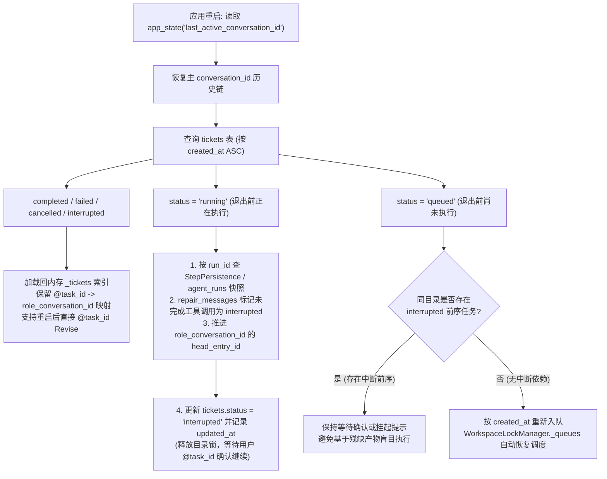

# 重启恢复扩展设计：`tickets`（Tasks）状态恢复与断点续跑

本文是对 [Super-Agent 架构设计](./1117-super-agent.md) 与 [Context Tree 架构设计](./1117-conversation-tree.md) 的补充，专门解决**应用重启或异常退出后，后台并发/排队任务（`tickets`）如何与主对话同步恢复**的问题。

> [!NOTE]
> **术语来源说明**
> 本方案严格沿用 Pydantic AI 的会话与运行术语：
> - **`conversation_id`**：对应 Pydantic AI `Conversation.conversation_id`，用于标识主对话与各 `@task_id` 对应的 Role 子上下文链（详见 [Pydantic AI Message History 官方文档](https://ai.pydantic.dev/message-history/)）。
> - **`run_id`**：对应 Pydantic AI `RunContext.run_id`，用于定位单次 `agent.run()` 的 `StepPersistence` 快照与中断工具调用修复（详见 [Pydantic AI Agents 官方文档](https://ai.pydantic.dev/agents/)）。

---

## 一、 为什么 `app_state` 只存 `last_active_conversation_id`，而 `tasks` 从 `tickets` 表恢复

1. **`app_state` 仅负责定位入口主会话**：一个主 `conversation_id` 下可能同时挂载多个后台任务，它们已通过 `main_conversation_id` 持久化在 `tickets` 表中。重启时先读取 `app_state('last_active_conversation_id')` 恢复主对话上下文，即可按 `main_conversation_id`（或全局扫描未完结任务）一次性加载全部关联 `tickets`。
2. **核心难点在于运行态恢复而非索引定位**：进程退出后内存中的 `asyncio.Task` 与 `WorkspaceLockManager` 目录锁全部清空。若直接把数据库中残留的 `running` / `queued` 记录当成仍在运行，会产生“僵尸锁”和“永久饥饿队列”；若在未确认副作用的情况下盲目自动重跑 `running` 任务，又可能重复写入文件或重复执行外部命令。

---

## 二、 重启恢复分类策略与流程

应用启动并初始化 SQLite 数据库后，在打开 `WorkspaceLockManager` 前先执行一次 **`recover_tickets()`**，按 `tickets.status` 分三类处理：



| 退出前状态 | 是否有工具副作用 | 重启恢复动作 | 用户后续交互方式 |
| :--- | :--- | :--- | :--- |
| **`completed` / `failed` / `cancelled` / `interrupted`** | 已落盘 | 原样加载至 `_tickets[(main_conversation_id, task_id)]`，保留 `@task_id` 映射。 | 直接 `@T1` 发起 **Revise**，沿用原 `role_conversation_id` 上下文链续跑。 |
| **`running`** | **可能有** | 通过 `run_id` 读取 `StepPersistence` 最新快照（含 `capture_frontier=True`），调用 `repair_messages` 将悬空工具调用标记为 `interrupted` 并保存 `role_conversation_id`；将 `tickets.status` 置为 **`'interrupted'`**，释放目录锁。主对话自身 `last_active_conversation_id` 若存在未闭合 frontier 快照，同样在 `bootstrap()` 阶段通过 `repair_interrupted_conversation` 自动修补。 | `open_runtime` 记录 `recovery_summary` 并通过 `enqueue_system_notice` 注入提示，用户下次交互时由 Router 播报中断摘要；用户检查或回复 `@T1 继续` 后，再通过 Revise 续跑或 `cancel_task` 取消。 |
| **`queued`** | **无**（未启动） | 若与中断目录存在嵌套重叠（`paths_overlap`），或 `depends_on_json` 中存在 `failed` / `interrupted` 上游任务，保持 `'queued'` 挂起等待处理上游；否则按 `created_at` 顺序重新入队 `WorkspaceLockManager` 自动调度。 | 无阻断依赖时自动执行；存在阻断上游时只能处理上游（Revise 成功或取消上游后自动放行下游）。 |

---

## 三、 `tickets` 表 Schema 调整

为区分**用户主动取消（`cancelled`）**与**进程退出/崩溃中断（`interrupted`）**，并记录每次恢复或状态流转时间，`tickets` 表补充两处定义：

1. `status` 的 `CHECK` 约束新增 `'interrupted'`：`('queued', 'running', 'completed', 'failed', 'cancelled', 'interrupted')`。
2. 新增 `updated_at TEXT NOT NULL` 字段，用于记录任务创建、入队、中断及结算的最近更新时间。

---

## 四、 `tickets` 重启恢复核心实现参考

以下逻辑在服务启动阶段运行（严格捕获具体异常，不吞掉 `asyncio.CancelledError`）：

```python
from __future__ import annotations

from datetime import UTC, datetime
from typing import Protocol

from pydantic_ai.conversation import Conversation
from pydantic_ai.conversation_store import ConversationConflict, ConversationStore
from pydantic_ai.messages import ModelMessage, repair_messages
from pydantic_ai_harness.step_persistence import StepStore


class TicketRecoveryStore(Protocol):
    conversation_store: ConversationStore
    step_store: StepStore

    async def list_recoverable_tickets(self, main_conversation_id: str) -> list[dict[str, str | None]]: ...

    async def mark_ticket_interrupted(self, *, main_conversation_id: str, task_id: str, summary: str, updated_at: str) -> None: ...


async def recover_main_conversation_tasks(
    *,
    store: TicketRecoveryStore,
    main_conversation_id: str,
) -> tuple[list[str], list[str]]:
    """重启恢复主会话关联的 tickets：修复中断任务并识别受阻塞的排队任务。"""
    rows = await store.list_recoverable_tickets(main_conversation_id)
    interrupted_dirs: set[str] = set()
    interrupted_ids: list[str] = []
    auto_requeue_ids: list[str] = []

    for row in rows:
        task_id = row["task_id"]
        status = row["status"]
        work_path = row["work_path"]
        if task_id is None or status is None:
            continue

        if status == "running":
            await _repair_running_task(
                store=store,
                main_conversation_id=main_conversation_id,
                task_id=task_id,
                role_conv_id=row["role_conversation_id"],
                run_id=row["run_id"],
            )
            if work_path is not None:
                interrupted_dirs.add(work_path)
            interrupted_ids.append(task_id)
        elif status == "queued":
            if work_path is None or work_path not in interrupted_dirs:
                auto_requeue_ids.append(task_id)

    return interrupted_ids, auto_requeue_ids


async def _repair_running_task(
    *,
    store: TicketRecoveryStore,
    main_conversation_id: str,
    task_id: str,
    role_conv_id: str | None,
    run_id: str | None,
) -> None:
    """将重启前未结算的 running 任务修补为 interrupted 并推进其 Role 子会话断点。"""
    if role_conv_id is not None and run_id is not None:
        snapshot = await store.step_store.latest_snapshot(run_id=run_id, include_interrupted=True)
        if snapshot is not None:
            repaired: list[ModelMessage] = repair_messages(snapshot.messages)
            scope = f"conv:{main_conversation_id}"
            conv = await store.conversation_store.load(role_conv_id, scope=scope)
            if conv is not None:
                merged = Conversation(
                    messages=repaired,
                    usage=conv.usage,
                    conversation_id=conv.conversation_id,
                    deferred_tool_requests=conv.deferred_tool_requests,
                    revision=conv.revision,
                )
                try:
                    await store.conversation_store.save(merged, scope=scope)
                except ConversationConflict:
                    pass

    now = datetime.now(UTC).isoformat()
    await store.mark_ticket_interrupted(
        main_conversation_id=main_conversation_id,
        task_id=task_id,
        summary="进程退出导致任务中断，已保留断点上下文，可 @task_id 确认后继续。",
        updated_at=now,
    )
```
