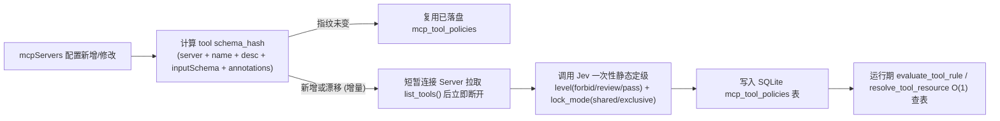

# 渐进披露（Tools / Skills / MCP）与 MCP 规则预编译设计规范

本文定义在现有 `Router + Role Agents + PermissionGuardHook + ToolExecutionQueueHook` 架构之上，引入 **Tools、Skills 与 MCP 渐进披露** 以及 **`mcpServers` 增量权限预编译** 的扩展设计规范。

---

## 一、 设计目标与核心原则

1. **最小常驻上下文与 Prefix Cache 稳定**：启动与常规请求不把海量工具 Schema、全量 `SKILL.md` 正文或外部 MCP 工具定义塞入 System Prompt 前缀；通过索引 + 增量 Delta Part 按需披露。
2. **权限与队列全覆盖**：无论通过 `ToolSearch` 动态激活的工具还是外部 MCP 工具，执行前均受最高优先级 `PermissionGuardHook (0)` 与 `ToolExecutionQueueHook (20)` 保护。
3. **MCP 预编译代替运行期重复定级**：`mcpServers` 配置变更时，仅对新增或 Schema 漂移的工具调用一次 `Jev`（`typesafe/jev-1.14`）完成静态定级并落盘，运行期 `evaluate_tool_rule` 实现 O(1) 查表。

---

## 二、 三大维度的渐进披露方案

### 1. Tools 渐进披露（基于 `pydantic_ai.capabilities.ToolSearch`）
- **常驻层**：`SuperAgentRouter` 仅暴露 6 个核心编排工具；Role Agent 仅常驻高频基础工具（如 `read_file`、`edit_file`、`list_files`）。
- **按需激活层**：低频/扩展工具集配置 `defer_loading`，默认仅向模型暴露轻量检索入口；模型检索命中后，由 Pydantic AI 通过增量 `ToolAvailabilityDeltaPart` 动态注入对应工具 Schema，不破坏前序 KV Cache。

### 2. Skills 渐进披露（基于 `pydantic_ai_harness.skills.Skills`）
采用三级按需披露并严格遵守 `AGENTS.md` 目录边界（**仅挂载于执行层 Role Agents**，`SuperAgentRouter` 不挂载 Skills，保持 6 核心编排工具与主会话零 Skill 污染）：
- **三层作用域平等加载与统一渲染**：工作区（`<work_path>/.agent/skills`）、全局（`~/.agent/skills`）、内置（`src/agent/skills`）统一通过公开 API `pydantic_ai_harness.skills.Skills.load()` 解析、校验与安全扫描，封装为 `Capability(defer_loading=True)` + `CombinedCapability` 交付框架 `DeferredCapabilityLoader`。本地运行时三层统一保持 `in_run_workspace=True`（L2 均输出 `Skill directory`），不因是否调用 `set_workspace` 或来源作用域区别对待（未绑定工作区时仅省略工作区层）。
- **L1 目录索引（常驻）**：注入动态 `instructions`（仅含 `name + description` 及可选 `when_to_use` 极简清单，不含正文步骤）；切换 `work_path` 时在请求尾部增量更新并自动撤回旧工作区已加载 Skill，保持前序 Prefix Cache 稳定。
- **L2 指令正文（按需）**：任务匹配某 Skill 时，模型调用 `load_capability` 获取该 `SKILL.md` 完整步骤，**仅在 Role 子会话内按需加载**，不写入主会话或无关分支的 `context_entries` 历史。
- **L3 附属资源（按需）**：`scripts/`、`references/`、`examples/` 仅在执行对应步骤时按需读取，受统一权限规则与队列锁保护。
- **Skill 零特权与跨工作区权限边界**：
  - 任何作用域（含全局/内置）的 Skill 均不享有路径白名单，其后续工具调用无差别受 `PermissionGuardHook (0)` 与 `ToolExecutionQueueHook (20)` 约束：
    - 跨工作区写 → `forbid` 硬拒（需由 Router 通过 `dispatch_role_agent` 另起绑定目标工作区的任务执行）；
    - 跨工作区读（含全局/内置 Skill L3 附属资源）→ 经 `FORBIDDEN_SENSITIVE_PATH_PATTERNS` 防逃逸后统一走 `review.path.outside_workspace_read`（`Jev` + `UserApprovalPort` 单次 `run_id` 临时授权；Step 6.5 在 `PermissionGuardHook (0)` 保护下解除 `FileSystem` 单根围栏以打通审过放行）；
    - 跨工作区 `shell` → 命中 `review.cmd.outside_workspace_access`；未绑定工作区 → fail-closed；
    - `load_capability`（`tool_kind="capability-load"`）在 `ToolExecutionQueueHook` 中归为 `lock_mode="none"`，避免误抢工作区写锁。

### 3. MCP 渐进披露、认证模型与懒连接（基于 `MCPToolset` + `MCP` Capability）
- **协议与复用底座**：基于已安装的 `mcp`（支持 `2026-07-28` 无状态协议、`server/discover`、MRTR 与 Extensions）+ `fastmcp` + `pydantic_ai.mcp.MCPToolset`，由底层统一屏蔽无状态 HTTP 与有状态 Stdio/SSE 差异。由于 `pydantic_ai.capabilities.MCP(url=...)` 不透传 `auth` / `verify` / `StdioTransport`，且 `load_mcp_toolsets()` 不支持 `auth` 与两级合并，统一由自研薄 Loader 构造配置完整的 `MCPToolset` 后封装为 `MCP(local=toolset, ...)`（或按 `defer_loading` 挂载）。
- **配置边界**：支持合并「全局配置（`~/.agent/mcp.json`）+ 当前工作区自身配置（`<work_path>/.agent/mcp.json`）」，支持 `${VAR}` / `${VAR:-default}` 环境变量展开；遵循 `AGENTS.md` 边界原则，不向上继承父目录。项目级配置不得越权读取或复用全局同名 Server 的已授权 OAuth Token。
- **MCP 认证模型（Auth）与“外部扩展授权 / Role 运行期只读消费”严格解耦**：
  - **核心架构红线（Role Agent 零 OAuth 参与）**：
    - **MCP OAuth 授权是独立的外部扩展管理行为**，仅由外部扩展接口（GUI 协议 `POST /v1/mcps/{name}/auth` 或 CLI `agent mcp auth <name>`）显式触发；
    - **Role Agent 工具集（`select_mcp_capabilities_for_role`）与预编译探测器（`FastMcpProbeAdapter`）严禁参与任何 OAuth 流程**，严禁挂载 `fastmcp.client.auth.OAuth` / `OAuthClientProvider` 状态机（即在 Role Agent 运行期绝对不执行 `.well-known` 发现、不执行 `POST /oauth/register` 动态客户端注册、不生成授权 URL、不触发 `redirect_handler`）。
  - **Stdio**：通过 `command` / `args` / `env`（`${VAR}` 注入）传递本地凭据，不走 HTTP OAuth。
  - **HTTP / SSE 认证映射（分路径隔离）**：支持 `headers`（自定义 Header）以及结构化 `auth` 块：
    - `none`（默认）；
    - `bearer`：`token`（支持 `${VAR}`，映射为静态 `fastmcp.client.auth.BearerAuth`）；
    - `oauth`（OAuth 2.1 + PKCE）：支持 `scopes`、`client_id`、`client_secret`、`callback_port`、`client_metadata_url`，按触发路径严格一分为二：
      1. **外部扩展授权路径（`run_interactive_oauth`，仅限 `POST /v1/mcps/{name}/auth` 与 `agent mcp auth <name>`）**：
         - 完全独立于 `MCPToolset` / `FastMCPClient`，直接由 `run_interactive_oauth(spec)` 驱动 `_InteractiveOAuth` + `httpx2.AsyncClient` 完成 PRM（`/.well-known/oauth-protected-resource`）与 OASM 发现、全量 `scopes_supported` 申请、动态客户端注册（绑定稳定 `callback_port`）、拉起系统浏览器完成用户授权并回调落盘 `access_token`；
         - `_InteractiveOAuth._auth_flow` 必须通过 `try ... finally: await flow.aclose()` 保证在同一协程任务内释放 `anyio.Lock`，防止网络中断产生跨任务锁释放异常；
         - 即使目标 MCP Server（如 `knowra`）允许匿名请求返回 `200 OK`，当本地无有效 Token 时也强制触发完整 OAuth 授权；
         - 覆写 `redirect_handler` 直接拉起系统浏览器，**移除 `fastmcp` 默认在拉起浏览器前使用后端 `httpx2` 发起的多余预检 `GET` 请求**；
         - 若远端连接/代理 TLS 握手失败或用户未完成授权，接口捕获异常并返回结构化 `502`（`OAUTH_FLOW_FAILED` / `OAUTH_INCOMPLETE`，含 `format_exception_detail` 根因链），绝不抛出未捕获 `500`；授权成功后刷新 `WorkspaceMcpManager` 预编译快照。
      2. **Role Agent 运行期与预编译探测路径（`interactive=False`）**：
         - **只读准入校验（`LocalOAuthReadinessChecker`）**：无阻塞读取 `~/.agent/mcp_tokens/` 下该 Server 命名空间目录，**精确解析真实 Token 条目文件中的非空 `access_token`**（严格排除 `FileTreeStore` 自动生成的 `*-info.json` 集合头元数据文件、DCR `client_info` 文件与 `token_expiry` 文件），并校验未过期（`expires_at > now + 30s`）。若无有效 `access_token`，直接判定 `is_ready = False`，预编译器返回 `status="auth_required"` 并纳入 `blocked_servers`，**严禁挂载到任何 Role Agent**；
         - **纯静态 Bearer 注入**：当 `is_ready = True` 时，`build_fastmcp_auth(spec, interactive=False)` 直接从本地已落盘的 Token 存储中提取 `access_token` 字符串，构造**纯静态 `BearerAuth(access_token)`** 注入 `MCPToolset`。若运行期远端吊销 Token 返回 `401`，直接作为常规 HTTP/工具鉴权错误快速失败并使该工作区 MCP 缓存失效（回退为 `auth_required`），绝不在 Role Agent 内部启动 OAuth 状态机。
    - `oauth_client_credentials`（无头 M2M，映射为 `ClientCredentialsOAuthProvider`）：支持 `client_id`、`client_secret`、`scopes`、`token_endpoint_auth_method`、`issuer`，支持全自动无头换取与预编译；
    - `oauth_private_key_jwt`（可选扩展）：JWT 断言认证。
  - **OAuth Token 持久化存储**：复用 `py-key-value-aio` 的 `FileTreeStore`（存放在 `~/.agent/mcp_tokens/`，目录 `0700` / 文件 `0600`，支持可选 `FernetEncryptionWrapper` 静态加密），存储键绑定 `(scope, server_name, endpoint_fingerprint)`。
- **Elicitation / Sampling 策略（CLI 交互优先，后台无非必要兜底）**：
  - `MCPToolset` 默认不传 `elicitation_handler` 与 `sampling_model`（均为 `None`），在协议能力协商阶段不声明对应能力，确保绝大多数纯 Tool Server 零副作用、强依赖 Server 直接按工具失败处理而不静默挂死。
  - **Elicitation**：仅在 **CLI 交互模式**（存在 TTY）下按需注入轻量终端 `elicitation_handler`；后台 `WorkspaceLockManager` Worker 保持 `None`，现阶段不增加跨协程 `Ticket` 挂起兜底。
  - **Sampling**：前期默认禁用（`None`），避免第三方 MCP Server 擅自触发额外 LLM 消耗；后续仅对显式配置信任的 Server 开放。
- **多 Role 共享持有（多对多而非唯一绑定）**：
  - 同一 Tool 集或 MCP Server 可同时挂载给多个合适角色（如 `roles: ["researcher", "coder"]` 或 `["coder", "tester"]`），而非排他性 1:1 唯一绑定；
  - 若用户在某 Server 下显式声明 `"roles": [...]`，按指定角色集合挂载；
  - 若外部用户未指定 `roles`，在预编译阶段由 `Jev` 产出多选集合 `recommended_roles` 并落盘（纯只读/检索类可同时分派给 `researcher`、`reviewer`、`coder`；含写/变更/构建类仅分派给 `coder`、`tester`）。**严禁使用硬编码默认角色（如 `("coder",)` 或 `"all"`）兜底**：若 `Jev` 无法判断或报错，该 MCP 必须判定为**不可用**（`recommended_roles = ()`，不挂载给任何 Role），并向用户与 Router 明确暴露报错信息。`Router` 不挂载任何重型 MCP。
- **按需懒连接与多 Role 并发隔离**：Role Worker 运行时按 `role.name in server.roles` 过滤出该角色持有的 `MCPToolset` 子集（工具较多时结合 `ToolSearch` 延迟披露 Schema），每次任务在独立 `async with agent:` 作用域内按需建立并释放连接，连接实例互不干扰、杜绝僵尸子进程。
- **同用户跨 Role 全工具共享协调（`ToolLockCoordinator`）**：连接隔离不能隔离底层共享状态（不仅是 Postgres/Playwright 等有状态 MCP，也包括本地重叠路径、命令句柄与会话控制工具）。`ToolExecutionQueueHook` 在 `open_runtime` 装配时统一注入同一个进程级 `ToolLockCoordinator` 覆盖**所有工具**（本地文件、`shell`、Router 工具与 MCP 工具）：无状态只读操作（`shared`）跨 Role 并发；所有**有状态或有副作用的工具（`exclusive`）**按各自资源键（`path:<...>`、`ws:<...>`、`cmd:<...>`、`conv:<...>`、`mcp_server:<endpoint_fingerprint>`）跨 Role 与 Router 全局协调串行。

---

## 三、 `mcpServers` 增量权限与队列预编译

1. **增量探测与断连**：仅对新增或配置变更的 `mcpServers` 建立短暂连接拉取 `list_tools()`，获取 `name`、`description`、`inputSchema` 与 `annotations`（如 `readOnlyHint` / `destructiveHint`）后立即关闭连接，保持运行时懒加载特性。
2. **`Jev` 一次性静态定级**：
   - **权限级别（`level`）**：
     - `forbid`：高危破坏/删库/凭据导出类 MCP 工具 → 运行期直接硬拒；
     - `review`：外部写操作/发消息/变更状态/敏感数据读取 → 运行期走 `PermissionReviewer`（结合 `user_intent` + `UserApprovalPort`）；
     - `pass`：纯只读无副作用检索（结合 `readOnlyHint=True` 且 `Jev` 确认无敏感风险）→ 运行期零 RTT 直接放行。
   - **队列锁模式与角色推荐**：同时输出 `lock_mode`（`shared` / `exclusive`，资源键 `mcp:<server_name>:<tool_name>`）与 `recommended_roles`（当用户配置未显式指定 `roles` 时生效）。
3. **Fail-Closed 不可用与禁止掩盖错误**：
   - **禁止用降级策略掩盖预编译错误**：`mcp.json` 解析/环境变量展开失败、`Jev` 请求异常（如 404/超时/网络错）或返回缺项/未知 `role_group` 时，预编译器必须将 `McpCompileEntry.status` 标记为 `"error"` 并保留真实 `error` 信息，**严禁将降级猜测结果写入 `mcp_tool_policies` 伪装成 `"compiled"`/`"cached"`**，同时将其纳入 `blocked_servers` 并在 `/v1/mcps` 与 `<workspace_capabilities>`（`status="error"`, `roles="none"`）如实暴露；
   - 未在 `mcp_tool_policies` 登记或运行时 `schema_hash` 漂移的 MCP 工具，运行期执行阶段由 `PermissionGuardHook` 兜底为 `REVIEW + exclusive`（绝不静默 `pass`），而角色分配阶段对无法判断危害的 MCP 直接按**不可用（不挂载）**处理。

---

## 四、 Hook 优先级集成

通过 `src/agent/hooks/priority.py` 的 `sort_capabilities` 统一保持：
- `PermissionGuardHook (0)` > `POLICY (10)` > `ToolExecutionQueueHook (20)` > `ToolSearch / Skills / MCP (50)` > `StepPersistence (90)`。

---

## 五、 Skill 与 `mcpServer` 的去重与版本控制策略

采用 **“作用域覆盖优先为主 + 同级 SemVer 仲裁为辅 + 指纹绑定缓存版本”** 统一策略：

### 1. Skill 去重与版本选择
- **去重主键**：`SKILL.md` frontmatter 中的 `name`。
- **跨作用域覆盖**：优先级固定为 **当前工作区（`<work_path>/.agent/skills`） > 用户全局（`~/.agent/skills`） > 应用内置**；项目本地同名 Skill 直接覆盖全局，不用全局高版本逆转项目边界。
- **同作用域冲突（SemVer 仲裁）**：同作用域冲突发生在同作用域多目录场景（如工作区 `[".agent/skills", ".agents/skills"]` 或全局多目录）。支持 frontmatter 顶层 `version` 或 `metadata.version`（缺省 `"0.0.0"`，按 SemVer 2.0.0 比较）。同一作用域下出现同名 Skill 时优先保留 SemVer 较高版本；同版本则保留先扫描项并在 `skipped` 记录告警；损坏/无效 `SKILL.md` 先入 `skipped(reason="invalid")`，不遮蔽低版本有效项；被 `ArtifactScanner` 拦截的 `flagged` 项保留占位，防止低优先级副本顶替。

### 2. `mcpServer` 去重、版本锁定与策略失效
- **两层去重**：
  1. **名称去重（`server_name`）**：合并全局与工作区 `mcp.json` 时，**工作区同名 Server 整体覆盖全局条目**（整条替换，不跨源拼接 `command` 与 `args`）。
  2. **同源去重与脱敏指纹（`endpoint_fingerprint`）**：对 stdio（规范化 `command + args`）或 HTTP/SSE（规范化 `url + auth.type + client_id/issuer`）计算端点指纹。**`endpoint_fingerprint` 严禁包含 `token`、`client_secret`、`Authorization` 等动态或敏感凭据**，防止 Token 刷新或密钥轮换误触发全表策略失效；若同一 Role 下存在不同名但同源的 Server，保留高优先级作用域（工作区级）或同级高版本，避免重复注入两份相同工具。
- **版本锁定与缓存联动**：
  - 尊重项目工作区显式锁定的包版本/配置版本；同作用域多来源声明同一服务（按 `serverInfo.name` 识别）时选较高版本。
  - `mcp_tool_policies` 缓存键强绑定 `(server_name, server_version, tool_name, schema_hash)`：一旦 `@latest` 等配置导致底层 `serverInfo.version` 或任一工具 `inputSchema` 变化，指纹立即失配并仅对该增量工具重跑 `Jev` 定级，防止旧策略误用到新版。
