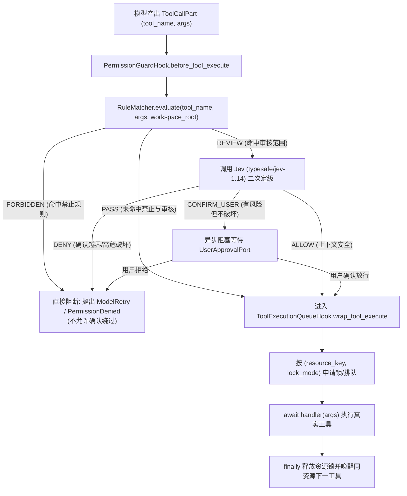

# 权限控制与 Agent Loop 内 Tools 任务队列设计规范

本文定义与现有 `Router + Role Agents` 体系正交的**强解耦权限控制（`permissions/`）**与**Agent Loop 内 Tools 读写并发调度队列（`hooks/`）**设计方案。

---

## 一、 核心设计原则

1. **三层强解耦**：
   - **规则声明层（`permissions/rules.py`）**：纯静态规则表与纯函数匹配器，零 IO、零 Runtime/Hook 依赖。
   - **审核决策层（`permissions/reviewer.py`）**：复用 `JevDecisionClient`（`typesafe/jev-1.14`）与抽象 `UserApprovalPort`，独立于具体终端/GUI/Router。
   - **Runtime 拦截与队列层（`hooks/`、`tools/`）**：通过 Pydantic AI `AbstractCapability` Hook 在工具执行边界拦截与排队（权限拦截在 `hooks/permission_hook.py`，优先级排序在 `hooks/priority.py`，Tools 资源队列调度在 `tools/tool_queue.py`），业务工具无感知。
2. **单一固定 Mode，不做白名单放行**：
   - 权限分级仅保留唯一固定 Mode，不做运行时动态范围调整。
   - **不做白名单放行**（规则面过大、不可控），只显式维护 **`FORBIDDEN`（禁止 Rules）** 与 **`REVIEW`（审核范围 Rules）**；未命中这两类的常规受限工作区内操作默认放行。
3. **先审后排（不带锁等待人工确认）**：
   - 权限拦截与异步阻塞审核在拿工具资源锁**之前**完成，避免等待 `Jev` 或用户确认期间长期占用文件/目录锁饿死并发读工具。

---

## 二、 权限分级与拦截流程

### 1. 规则声明层（`src/agent/permissions/rules.py`）
- **`FORBIDDEN`（禁止 Rules）**：绝对红线，例如：
  - 破坏性系统/磁盘/进程命令（`rm -rf /`、`mkfs`、`dd if=`、`shutdown` 等）；
  - 越界写入/删除受限工作区之外的路径，以及未绑定受限工作区（`workspace_root=None`）时的写文件操作（fail-closed）；
  - 读取或外传敏感凭证（`.env`、SSH 私钥、`id_rsa`、系统密钥目录）；
  - 不可逆高危 Git/数据操作（`git push --force`、`git reset --hard`、删库命令等）。
- **`REVIEW`（审核范围 Rules）**：按**读写与数据影响**综合定级为“有风险但不必然破坏”（任何作用域的 Skill 均不享有路径白名单，遵循单一固定 Mode）：
  - 工作区外的只读文件访问（`review.path.outside_workspace_read`），以及未绑定受限工作区时的只读文件/Shell 访问（fail-closed）；
  - 修改关键构建/环境/权限配置文件（如 `pyproject.toml`、`package.json`、Dockerfile、CI 配置）；
  - `shell` / `run_command` 执行包安装、外部网络访问（`curl`/`wget`）、进程控制、批量文件操作，或引用/执行受限工作区之外的路径/脚本（`review.cmd.outside_workspace_access`）；
  - 数据库写操作或读取可能包含敏感字段的数据表。

### 2. 审核决策层（`src/agent/permissions/reviewer.py`）
- 复用公共 `JevHttpClient`（`src/agent/llm/jev_client.py`，含 `/alpha/decisions` 与 Logfire span）；若 `Jev` 请求超时或网络异常，fail-closed 自动降级为 `CONFIRM_USER`。
- **语义授权识别（用户显式要求 vs 模型隐式触发）**：调用 `Jev` 时将 `user_intent`（当前用户输入 / 任务 `mandate`）一并传入 `state`：
  - **`ALLOW`**：用户在输入中**明确指定**了该操作/包名/目标且不触及 `FORBIDDEN` 红线，直接放行；
  - **`CONFIRM_USER`**：用户只提了高层目标（如“初始化项目”），由模型自行决定包安装或外部网络请求，触发一次人工确认；
  - **`DENY`**：越界或高危破坏，升级为禁止。
- **批量合并与单次 `run_id` 同类临时授权**：
  - 同轮并发多个需要 `CONFIRM_USER` 的工具调用通过微批窗口合并为**一次 `UserApprovalPort.request_batch_approval(items)` 确认**；
  - 用户确认时可附带 `grant_categories_for_run`（仅在当前 `run_id` 生命周期内临时放行同类操作，Worker `finally` 阶段通过 `release_runs()` / `clear_run()` 销毁，**不构成永久白名单**）。

---

## 三、 Hook 优先级机制（Pydantic AI 支持情况）

1. **Pydantic AI 原生机制**：
   - 经检查 `pydantic_ai.capabilities.combined.CombinedCapability`：`before_tool_execute` 与 `wrap_tool_execute` **均未内置数值 `priority` 字段**，完全按 `Agent(capabilities=[cap_0, cap_1, ...])` 的**传入顺序**调度：
     - `before_tool_execute`：**正序串行**执行 `cap_0 → cap_1 → ...`；
     - `wrap_tool_execute`：**洋葱模型逆序包裹**，`cap_0` 在最外层（最先进入、最后退出）。
2. **本系统优先级保证方案**：
   - 在 `RoleSpec.build_agent` / `SuperAgentRouter` 中引入显式优先级排序约定（如 `HookPriority`：`PERMISSION=0 < POLICY=10 < TOOL_QUEUE=20 < OBSERVABILITY=30 < PERSISTENCE=90`），装配 `capabilities` 时按优先级稳定排序：
     1. **`PermissionGuardHook`（最高优先级 `0`）**：最先执行 `before_tool_execute`，命中禁止或审核拒绝时直接短路抛出异常，后续排队、统计、持久化 Hook 均不触发。
     2. **后续扩展同类型 `before_tool_execute` Hook（如参数脱敏/审计）**：排在权限 Hook 之后，只处理已通过权限校验的合法调用。
     3. **`ToolExecutionQueueHook` + `ToolLockCoordinator`（`src/agent/tools/tool_queue.py`，`wrap_tool_execute`）**：同时装配于 Role Agent 与 `SuperAgentRouter`，在权限校验全部通过后才申请资源锁，确保不持锁等待人工确认；`open_runtime` 注入共享 `ToolLockCoordinator`，按资源作用域精确判定冲突——工作区局部工具（`kind="path"`，如 `write_file`/`shell`）仅在路径重叠时互斥、异目录/异文件完全并发；全局唯一有状态/有副作用资源（`kind="exact"`，如未来有状态 MCP `mcp_server:<endpoint_fingerprint>`、进程句柄 `cmd:<id>`）则跨 Role 按精确键全局串行。

---

## 四、 现有工具整理：状态、副作用与并发/串行队列策略

Pydantic AI 单轮模型输出多个 `ToolCallPart` 时默认以 `asyncio.gather` 并发执行。`ToolExecutionQueueHook` 参考 `LockQueueState` 拓扑，按工具的**状态（有/无）**与**副作用（有/无）**决定异步并发或串行依赖：

| 来源模块 | 工具名称 | 状态（有/无） | 副作用（有/无） | 队列策略（`lock_mode`） | 资源键（`resource_key`） |
| :--- | :--- | :--- | :--- | :--- | :--- |
| **Harness `FileSystem` / `Coder`** | `read_file`、`file_info` | 无状态 | 无副作用 | **`shared`（共享读锁，可并发）** | 目标文件规范路径 |
| **Harness `FileSystem` / `Coder`** | `list_directory`、`list_files`、`search_files`、`find_files`、`grep` | 无状态 | 无副作用 | **`shared`（共享读锁，可并发）** | 目标目录规范路径 |
| **Harness `FileSystem` / `Coder`** | `write_file`、`edit_file`、`create_directory` | 有文件状态变更 | **有写盘副作用** | **`exclusive`（写互斥，防饥饿串行）** | 目标路径（含父子重叠 `paths_overlap`） |
| **Harness `Coder` / `Shell`** | `shell`、`run_command`、`start_command` | 有进程/工作区状态 | **有命令与写盘副作用** | **`exclusive`（工作区独占串行）** | 工作区根目录 `workspace_root` |
| **Harness `Shell`** | `check_command`、`stop_command` | 有后台进程状态 | `stop` 有状态变更 | **`exclusive`（按进程句柄串行）** | 命令/会话 ID（`cmd:<id>`） |
| **Router 工具集** | `list_tasks`、`inspect_workspace_locks` | 无状态 | 无副作用 | **`none`（无锁直接并发）** | — |
| **Router 工具集** | `set_workspace` | 有会话状态（`work_path`） | 有状态变更 | **`exclusive`（按主会话串行）** | `conv:<main_conversation_id>` |
| **Router 工具集** | `dispatch_role_agent` | 有账本状态（`tickets`） | 有派发副作用 | **`exclusive`（按主会话串行/内部 `_dispatch_lock`）** | `conv:<main_conversation_id>` |
| **Router 工具集** | `steer_or_revise_task`、`cancel_task` | 有任务状态 | 有控制副作用 | **`exclusive`（按任务靶向串行）** | `ticket:<main_conv_id>:<task_id>` |
