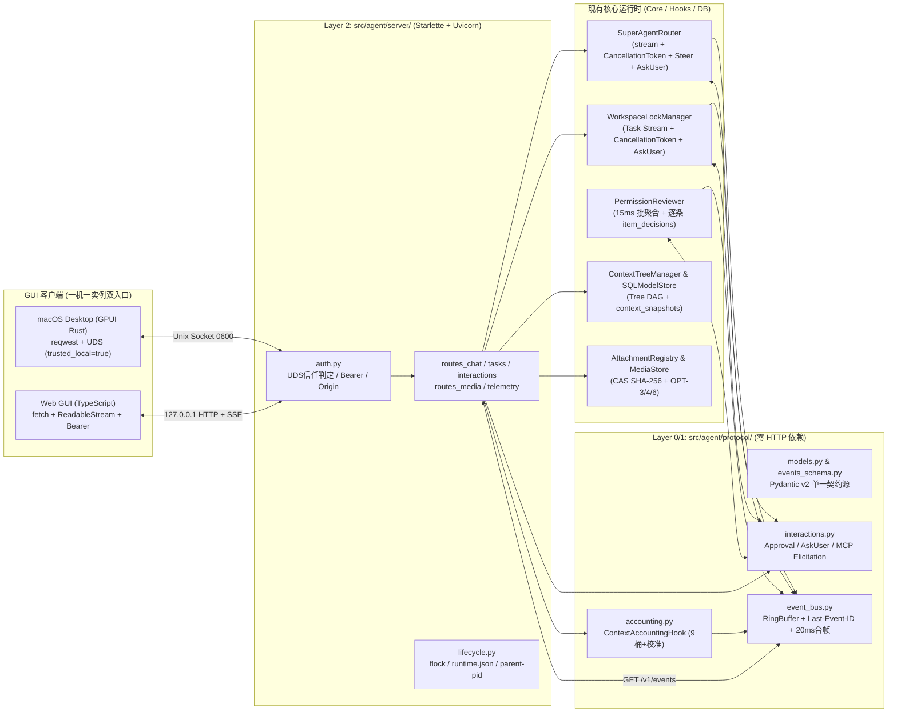
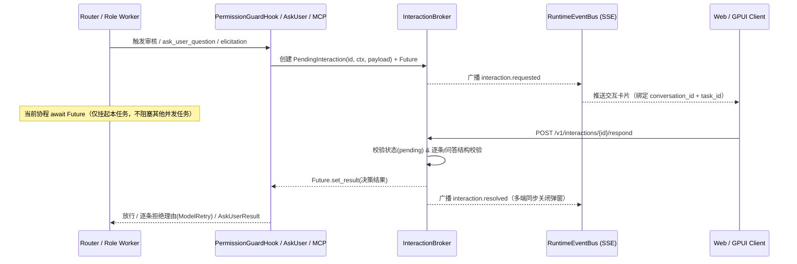

# 外接通信协议（GUI Protocol）、交互中心与上下文计量设计规范（Spec）

- **基线阶段**：Step 11.1–11.4 完成后（Attachment/Artifact 与 OPT-3/4/6 存储层已落盘）
- **关联计划文档**：[1120-gui-protocol-plan.md](./1120-gui-protocol-plan.md)
- **适用前端**：Web 端（TypeScript / Browser）与 macOS Desktop（Rust + GPUI）
- **已拍板核心决策**：
  1. **一机一实例（Single-Instance Local Runtime）**：本机单实例常驻/Sidecar 运行，基于 `~/.agent/runtime.lock` + `~/.agent/runtime.json` (`0600`)，同时监听 **Unix Domain Socket (`~/.agent/runtime.sock`, `0600`)** 供 GPUI 直连与 **Localhost HTTP (`127.0.0.1:<port>` + Bearer Token)** 供本地 Web GUI 接入。
  2. **逐条勾选权限审核（Per-Item Granular Approval）**：保留 `PermissionReviewer` 同轮 15ms 并发批聚合，批内每个 `ApprovalItem` 分配唯一 `item_id`，支持逐条勾选允许/拒绝与单条 `grant_category_for_run`，未显式裁决条目严格 `fail-closed` 拒绝。
  3. **Router 与 Role Agents 全面挂载 `AskUser`**：直接复用内置 `pydantic_ai_harness.ask_user.AskUser` Capability，同时挂载到 `SuperAgentRouter` 与 `WorkspaceLockManager` 的 Role Workers，通过统一 `InteractionBroker` 向 GUI 推送结构化多选建议卡片。

---

## 一、 背景、设计目标与传输架构选型

### 1.1 核心需求与现有运行时的契合点

本项目的核心运行时（[runtime.py](../src/agent/core/runtime.py)、[router.py](../src/agent/core/router.py)、[scheduler.py](../src/agent/core/scheduler.py)）是一个**异步多任务协调系统**，而非传统的单回合请求-响应聊天机器人。GUI 外接通信协议层需要一次性完整支撑以下 10 项能力：

1. **持久 SSE 消息流**：实时接收前台 Router、后台主动汇报与（按需订阅的）后台 Role Worker 输出流。
2. **消息发送与多模态附件传递**：支持拖拽/上传图片、音频、视频、PDF、文本与桌面本地路径直注，复用 `AttachmentRegistry` + `CompressedFileMediaStore` 实现 SHA-256 去重。
3. **流式应答与溯源引用**：增量推送文本、思考过程（Thinking）、工具调用/返回与物理核验后的 `VerifiedCitation`。
4. **逐条勾选权限审核**：对接 `PermissionReviewer` 15ms 批聚合，支持单条通过、单次运行同类授权及附言拒绝。
5. **双向中断与建议注入（Interrupt & Steer）**：随时打断前台 Router 或后台 Role Task 保留断点，或向运行中/排队中/已结束的会话与任务追加纠偏建议。
6. **回答 LLM 的选择建议**：通过 `pydantic_ai_harness.ask_user.AskUser` 弹出结构化选项与自定义附言框，同时区分非阻塞的快捷操作建议（`suggested_actions`）。
7. **Role Agent Task 实时进度与目录锁监控**：展示任务状态、瞬时运行阶段、工具轨迹、依赖阻塞关系、预算水位与目录读写锁占用。
8. **Conversation Tree 可视化与树操作**：展示主分支树、Role 子会话树、分叉锚点与 `stop_backtrack` 截断边界，支持建枝、切换、Fork、Handoff。
9. **Context Window 分类消耗透视**：精确拆分并校准 `system_prompt`、`environment_info`、`skills`、`mcp`、`builtin_tools`、`memory`、`attachments`、`messages`、`overhead` 9 类窗口占用及省流指标。
10. **三层 Token 与费用统计**：提供 Step 瞬时水位、Run/Task 累计消耗（对照 `LoopBudgetPolicy`）与 Conversation Tree 全局汇总（含 Jev 辅助决策消耗隔离）。

### 1.2 为什么选择“CQRS + 运行时级持久 SSE 总线”

如果采用“一次 `POST /chat` 对应一条单次 SSE”的传统协议（如纯 AG-UI 或 Vercel AI Data Stream），在当前架构中会出现结构性缺口：
- **后台主动回流无处投递**：`SuperAgentRouter` 派发 Role 任务后立即返回，数分钟后 `WorkspaceLockManager` 完成任务并触发 `on_ticket_event` → `_run_proactive_report` 主动向用户播报结果，此时原始 `POST` 早已结束。
- **跨协程异步交互**：多个并发 Role Worker 可能同时触发 `PermissionReviewer` 审批或 `AskUser` 提问，需要全局统一的收发通道。
- **启动恢复通知**：`open_runtime` 在重启恢复时会产出 `recovery_summary` 与 `recovery` 系统提示，GUI 建连后必须立即收到并渲染。
- **零重依赖落地**：当前 `.venv` 已内置 `starlette==1.10.0`、`sse-starlette==3.7.0`、`uvicorn==0.54.0`、`tiktoken==0.14.0`、`pydantic==2.14.3` 以及 `pydantic_ai_harness.ask_user`，无需引入 gRPC 编译链或第三方协议栈。

因此，本协议采用 **HTTP/JSON 命令查询 + 运行时级持久 SSE 事件总线（CQRS + Event Sourcing Lite）**：
- **命令与查询走 REST (`/v1/...`)**：发送消息、上传附件、中断、Steer、审批响应、树操作均由 REST 接口提交，立即返回确认回执（`200` / `202`）。
- **状态与流式输出走持久 SSE (`GET /v1/events`)**：单一（或按会话过滤的）长连接承载所有异步流、状态跃迁、交互请求、上下文与用量快照；如未来需接入第三方 AG-UI 客户端，可在 `server/` 最外层追加无状态 Adapter 转换，无需改动内核。

### 1.3 一机一实例部署与双传输安全模型

基于已确认的**一机一实例**决策，本机在同一时刻仅运行一个 Backend Runtime 进程，同时服务本机 GPUI Desktop 与本机 Web GUI：

| 组件 | 路径 / 地址 | 权限与安全边界 | 职责 |
| :--- | :--- | :--- | :--- |
| **实例互斥锁** | `~/.agent/runtime.lock` | `fcntl.flock(LOCK_EX \| LOCK_NB)` | 防止双启进程并发读写同一份 SQLite WAL 与 `media_blobs/`；退出或崩溃时内核自动释放锁 |
| **实例发现文件** | `~/.agent/runtime.json` | 文件权限 `0600`，UUID 临时文件原子替换 | 记录 `{ "pid", "uds_path", "http_url", "auth_token", "protocol_version", "started_at", "db_path" }` 供 GPUI 与本地 CLI/Web 发现 |
| **UDS 监听端点** | `~/.agent/runtime.sock` | Socket 权限 `0600`（仅当前 OS 用户可连接） | **GPUI macOS Desktop 首选通道**；服务端标记 `trusted_local=True`，允许调用 `/v1/attachments/local` 零拷贝路径注册，免端口冲突、天然免疫浏览器 CSRF 与 DNS Rebinding |
| **HTTP 监听端点** | `http://127.0.0.1:<port>` | 强制 `Authorization: Bearer <256-bit 随机 Token>` + 严格校验 `Host` 与 `Origin` 白名单 | **本机 Web GUI 通道**；禁止使用 `0.0.0.0`，禁止 `/v1/attachments/local` 本地任意路径探测 |
| **Sidecar 守护** | `agent serve --uds ... --parent-pid <pid>` | 定时检测父进程存活（`os.kill(ppid, 0)`）+ 监听 `SIGTERM`/`SIGINT` | 若 GPUI 作为父进程退出或崩溃，Backend 自动触发所有活跃 `CancellationToken`，等待 `StepPersistence` 与 `scheduler.wait_all()` 落盘后优雅清理 `runtime.sock` 与 `runtime.json` |

---

## 二、 总体架构与强解耦分层（Layer 0 / 1 / 2）

### 2.1 整体数据流与控制流



### 2.2 新增模块目录与单向依赖约束

严格遵守每文件 `< 500` 行与单向依赖原则（**`core/`、`hooks/`、`permissions/`、`db/`、`llm/` 严禁导入 `starlette`、`uvicorn` 或 `sse_starlette`**）：

```text
src/agent/
├── protocol/                     # Layer 0/1：纯协议模型、总线、交互与上下文计量（零 Web 框架依赖）
│   ├── __init__.py
│   ├── models.py                 # REST 请求/响应视图、ErrorEnvelope、Approval/AskUser/Task/Tree/Usage 模型
│   ├── events_schema.py          # SSE Envelope 与 8 大域判别联合事件模型
│   ├── event_bus.py              # RuntimeEventBus：异步 pub/sub、RingBuffer(5000)、Last-Event-ID、20ms Delta 微批
│   ├── interactions.py           # InteractionBroker：统一挂起管理（Approval 逐条裁决 / AskUser / MCP Elicitation）
│   ├── accounting.py             # ContextAccountingHook + tiktoken 9桶估算器 + RequestUsage 校准 + 省流指标
│   └── schema_export.py          # 导出 docs/schemas/events.schema.json 与 openapi.json 工具函数
└── server/                       # Layer 2：Starlette HTTP/SSE 传输层与进程守护
    ├── __init__.py
    ├── auth.py                   # UDS trusted_local 标记、Bearer 鉴权、Host/Origin 校验
    ├── lifecycle.py              # SingleInstanceLock (flock)、runtime.json 原子写、--parent-pid 守护
    ├── app.py                    # create_app(runtime, ...) 装配中间件、异常处理器与路由
    ├── routes_chat.py            # /health, /runtime/snapshot, /events, /tree, /conversations, /messages, /interrupt
    ├── routes_tasks.py           # /tasks, /steer, /cancel, /workspace-locks
    ├── routes_interactions.py    # /interactions, /interactions/{id}/respond
    ├── routes_media.py           # /attachments, /attachments/local, /attachments/{id}/content (Range), /artifacts
    ├── routes_telemetry.py       # /conversations/{cid}/context, /conversations/{cid}/usage
    └── cli.py                    # `agent serve` 命令行入口（注册至 pyproject.toml scripts）
```

---

## 三、 跨语言 Schema 契约规范（Web TypeScript + GPUI Rust `serde`）

### 3.1 单一契约源与自动生成链路

所有请求体、响应体、视图对象与 SSE 事件均在 `src/agent/protocol/models.py` 和 `src/agent/protocol/events_schema.py` 中以 **Pydantic v2 (`BaseModel`, `ConfigDict(extra="forbid")`)** 定义，构建/开发期通过命令导出：
1. `docs/schemas/openapi.json`：由 Starlette/Pydantic Schema 自动生成全部 REST 端点契约 → Web 端使用 `openapi-typescript` 生成 `protocol.d.ts`；GPUI 端使用 `progenitor` 或 `typify` 生成 Rust 类型与客户端。
2. `docs/schemas/events.schema.json`：导出 `ProtocolEvent` 判别联合 JSON Schema → 直接生成 TS Discriminated Union 与 Rust `#[serde(tag = "type", content = "payload")]` 枚举。

### 3.2 Rust `serde` 友好建模约束

1. **内部邻接标签（Adjacently Tagged）**：所有事件信封与多态 payload 固定携带显式字符串判别字段（如 `type: Literal[...]` + `payload: ...`、`kind: Literal[...]`），禁止依赖结构隐式推断（避免 `serde(untagged)` 歧义）。
2. **禁止裸 `Any` 与无约束嵌套字典**：除工具调用原始参数（`args: dict[str, JsonValue]`）和 MCP `requested_schema: dict[str, JsonValue]` 外，所有业务字段必须强类型具名。
3. **统一时间、序列号与版本**：
   - 时间字段统一 UTC RFC3339 字符串（如 `"2026-11-20T10:15:30.123456Z"`）；
   - SSE 事件携带全局单调递增整型 `seq: int`（`u64`）；
   - 顶层载荷固定携带 `protocol_version: Literal["1.0"]`。

### 3.3 统一错误信封（`ErrorEnvelope`）与 HTTP 状态码

```python
class ErrorEnvelope(BaseModel):
    protocol_version: Literal["1.0"] = "1.0"
    code: str               # 稳定机器可读错误码，如 "CONVERSATION_NOT_FOUND" / "UNTRUSTED_LOCAL_PATH"
    message: str            # 面向人类/UI 的错误描述
    detail: dict[str, JsonValue] = Field(default_factory=dict)
    retryable: bool = False
    request_id: str
```

| HTTP Status | 语义 | 典型 `code` |
| :---: | :--- | :--- |
| `400` / `422` | 请求参数或 Pydantic 校验失败 | `INVALID_ARGUMENT`、`VALIDATION_ERROR` |
| `401` / `403` | 缺失或无效 Bearer Token、Origin 非法、非 UDS 调用 `/attachments/local` | `UNAUTHORIZED`、`FORBIDDEN_ORIGIN`、`UNTRUSTED_LOCAL_ENDPOINT` |
| `404` | 会话、Task、Interaction、Attachment、Artifact 不存在 | `NOT_FOUND` |
| `409` | 状态冲突（如 Interaction 已被另一客户端处理、会话/任务当前不可中断或改道） | `INTERACTION_ALREADY_RESOLVED`、`STATE_CONFLICT` |
| `413` | 上传附件体积超过配置上限 | `PAYLOAD_TOO_LARGE` |
| `429` | 上游或本地限流队列已满 | `RATE_LIMITED` |

---

## 四、 持久 SSE 事件总线规范（`GET /v1/events`）

### 4.1 统一事件信封（Envelope）

每条 SSE 帧格式为标准 `id: <seq>\nevent: <type>\ndata: <json>\n\n`，其中 `data` JSON 结构如下：

```json
{
  "protocol_version": "1.0",
  "seq": 1042,
  "event_id": "0195a3c4-7b10-7000-8000-000000000412",
  "ts": "2026-11-20T10:15:30.123456Z",
  "conversation_id": "0195a3b0-0000-7000-8000-000000000001",
  "task_id": "T2",
  "role_name": "coder",
  "run_id": "run_0195a3c4",
  "type": "message.part.delta",
  "payload": {
    "part_index": 0,
    "part_kind": "text",
    "delta": "已完成解析器修复，正在运行单测...",
    "proactive": false
  }
}
```

### 4.2 断线续传、背压合帧与按需任务流订阅

1. **断线续传（`Last-Event-ID` + 有界 RingBuffer）**：
   - `RuntimeEventBus` 在内存中维护默认容量 `5000` 条的有界环形缓冲区 `deque[ProtocolEvent]`（含单调 `seq`）。
   - 客户端在 `GET /v1/events` 请求头带 `Last-Event-ID: <seq>`（或 Query 参数 `?after_seq=<seq>`）时，总线自动重放 `(after_seq, current_seq]` 区间事件。
   - 若 `after_seq < oldest_buffered_seq - 1`（缺口已被淘汰），总线立刻下发一条 `stream.resync_required`（携带 `oldest_seq` 与 `latest_seq`），客户端收到后调用 `GET /v1/runtime/snapshot` 无损重建全量 UI 状态。
2. **心跳保活**：每 `15s` 无业务事件时发送 SSE 心跳注释 `: heartbeat\n\n`（或可选 `heartbeat` 事件），避免代理/本地连接超时关闭。
3. **20ms Delta 微批合并（Coalescing）**：
   - 针对高频的 `message.part.delta`（同一 `(conversation_id, task_id, run_id, part_index, part_kind)`），`EventBus` 在 `20ms` 时间窗或累积 `16` 个字符阈值内将连续文本增量合并为单个 `message.part.delta` 下发，防止 React 状态树与 GPUI 120Hz 渲染线程被逐 Token 重绘打满；遇到 `message.part.end`、`tool_call` 或交互事件时立即冲刷缓冲。
4. **多 Role 并发流按需订阅**：
   - `GET /v1/events?conversation_id=<可选>&include_task_streams=<bool>` 默认仅推送：**主会话（Router 与主动汇报）全量流** + **所有后台任务的摘要事件**（`task.created`、`task.status_changed`、`task.progress`、`interaction.*`、`context.snapshot`）。
   - 后台 Worker 的全量文本/思考流默认标记为 `task_stream` 通道；仅当用户在 GUI 点开 `@T2` 详情抽屉时，客户端调用 `POST /v1/events/subscriptions`（传递 `{ "subscription_id": "...", "task_ids": ["T2"] }`）开启该任务的 `message.part.*` 全文推送，关闭抽屉即退订，避免 4 个 Role 并行思考打爆主 SSE。

### 4.3 8 大域完整事件清单

| 域 | Event `type` | 触发来源 | 核心 `payload` 字段 |
| :--- | :--- | :--- | :--- |
| **1. 连接与恢复** | `runtime.ready` | SSE 建连首帧 | `protocol_version`, `latest_seq`, `active_conversation_id`, `model_name`, `trusted_local`, `subscription_id` |
| | `runtime.recovery` | 启动恢复 / 建连补推 | `recovered_branches[]`: `{main_conversation_id, interrupted_task_ids[], requeued_task_ids[]}` |
| | `stream.resync_required` | `Last-Event-ID` 过期 | `requested_after_seq`, `oldest_available_seq`, `latest_seq` |
| **2. 消息与流式应答** | `run.started` | Router / Role `agent.run` 开始 | `agent_kind` (`"router"\|"role"`), `proactive: bool`, `entry_id`, `user_message_preview` |
| | `message.part.start` | `PartStartEvent` | `part_index`, `part_kind` (`"text"\|"thinking"\|"tool_call"\|"tool_result"\|"file"\|"system_notice"`), `tool_name?`, `tool_call_id?`, `attachment_id?`, `proactive` |
| | `message.part.delta` | `PartDeltaEvent`（经 20ms 合帧） | `part_index`, `part_kind`, `delta`, `tool_call_id?`, `proactive` |
| | `message.part.end` | `PartEndEvent` / 工具结果完成 | `part_index`, `part_kind`, `tool_name?`, `tool_call_id?`, `args_preview?`, `result_preview?`, `is_error?`, `proactive` |
| | `run.completed` | `agent.run` 正常结束并落盘 | `output_text`, `citations: VerifiedCitationView[]`, `suggested_actions: SuggestedAction[]`, `usage: RunUsageView`, `head_entry_id` |
| | `run.interrupted` | `CancellationToken` 取消并修补落盘 | `reason` (`"user_interrupt"\|"shutdown"\|"task_cancelled"`), `repaired_message_count`, `head_entry_id` |
| | `run.failed` | `AgentRunError` / `LoopSafetyAbortError` / `TimeoutError` | `error_code`, `error_message`, `abort_kind?`, `suggested_actions: SuggestedAction[]` |
| **3. 人机交互** | `interaction.requested` | `InteractionBroker` 挂起等待 | `interaction: InteractionView`（含 `kind`: `"approval"\|"ask_user"\|"mcp_elicitation"` 及对应强类型详情） |
| | `interaction.resolved` | 任意端响应完成后广播 | `interaction_id`, `kind`, `resolution_summary`, `resolved_by` |
| | `interaction.cancelled` | Run/Task 被中断或超时关闭 | `interaction_id`, `kind`, `reason` (`"run_cancelled"\|"timed_out"\|"shutdown"`) |
| **4. Role Task 与锁** | `task.created` | `WorkspaceLockManager.dispatch_task` | `task: TaskView` |
| | `task.status_changed` | 排队/启动/完成/失败/中断/取消 | `task: TaskView`, `previous_status`, `previous_phase` |
| | `task.progress` | Role Hook 步进与工具执行 | `task_id`, `live_phase`, `current_step`, `max_requests`, `tool_calls_count`, `max_tool_calls`, `soft_limit_triggered`, `active_tool?`, `recent_step?` |
| | `task.steered` | 实时注入或排队合并 | `task_id`, `mode` (`"live_steer"\|"queued_merge"\|"revise_restart"`), `instruction_preview` |
| | `workspace.locks_changed` | 锁获取 / 释放 / 入队 | `locks: WorkspaceLockView[]` |
| **5. Conversation Tree** | `tree.branch_created` | 新建/Fork/Handoff 分支 | `branch: BranchView`, `reason` (`"user_create"\|"user_fork"\|"semantic_fork"`) |
| | `tree.branch_switched` | 显式或语义路由切换焦点 | `previous_conversation_id?`, `active_conversation_id`, `reason` |
| | `tree.branch_updated` | 更新标题、`work_path`、`head_entry_id` | `branch: BranchView` |
| | `tree.entry_appended` | 主/子会话新节点写入 | `conversation_id`, `entries: EntrySummaryView[]`, `head_entry_id` |
| **6. Context 与用量** | `context.snapshot` | `ContextAccountingHook` 发送前与校准后 | `snapshot: ContextWindowSnapshotView`（含 `calibrated: bool` 与 9 桶分类） |
| | `usage.step_recorded` | 单次 Model 请求完成 | `conversation_id`, `task_id?`, `run_id`, `step_usage`, `run_usage`, `tree_usage` |
| | `usage.budget_warning` | 触发 80% 软着陆阈值 | `conversation_id`, `task_id?`, `run_id`, `dimension` (`"requests"\|"tool_calls"\|"tokens"`), `ratio` |
| **7. 附件与产物** | `attachment.registered` | 附件上传/注册/工具注册完成 | `attachment: AttachmentView` |
| | `artifact.updated` | `save_artifact` 写入或更新 | `artifact: ArtifactView` |
| **8. 并发池水位** | `llm.pool_status` | 进入/退出限流池或 429 冷却 | `router_pool`, `role_pool`, `jev_pool`, `cooldown_remaining_sec`, `total_429_hits` |

---

## 五、 核心业务交互协议与 REST API 契约（`/v1`）

### 5.1 REST 端点全表

| 分类 | 方法与路径 | 说明与权限要求 |
| :--- | :--- | :--- |
| **系统与流** | `GET /v1/health` | 健康检查、协议版本、`trusted_local` 与单实例信息（允许免 Token 或基础探测） |
| | `GET /v1/runtime/snapshot` | 首屏全量水合：活跃会话、完整 Branch Tree、运行/未决 Tasks、Pending Interactions、目录锁、最近 Context 快照、LLM 并发池水位 |
| | `GET /v1/events` | 持久 SSE 事件总线（支持 `Last-Event-ID`、`conversation_id`、`include_task_streams`） |
| | `POST /v1/events/subscriptions` | 动态更新某 SSE `subscription_id` 订阅的 `task_ids` 细粒度输出流 |
| **会话树** | `GET /v1/tree` | Level 1 宏观分支树（支持 `include_role_branches=true`） |
| | `POST /v1/conversations` | 从 `E_root` 创建新主分支并可选切换焦点 |
| | `POST /v1/conversations/{cid}/switch` | 切换活跃主会话（`ContextTreeManager.switch_conversation`） |
| | `POST /v1/conversations/{cid}/fork` | 从当前末端或指定 `at_entry_id` 派生 `full_fork` 或 `handoff` 分支 |
| | `PATCH /v1/conversations/{cid}` | 修改 `target_title` 或调用 `bind_workspace` 绑定/切换 `work_path` |
| | `GET /v1/conversations/{cid}/entries` | Level 2 微观 Entry DAG 分页读取（主会话与 Role 子会话通用） |
| **对话与控制** | `POST /v1/conversations/{cid}/messages` | 发送用户消息 + 附件 ID + `delivery_mode`（含幂等键 `client_message_id`） |
| | `POST /v1/conversations/{cid}/interrupt` | 优雅中断当前运行中的 Router 生成并保留修复后上下文 |
| **附件与产物** | `POST /v1/attachments` | `multipart/form-data` 上传文件注册到 `AttachmentRegistry`（SHA-256 去重） |
| | `POST /v1/attachments/local` | **仅限 UDS (`trusted_local=True`)**：提交本机绝对路径零拷贝注册 |
| | `GET /v1/attachments/{att_id}` | 获取附件元数据 `AttachmentView` |
| | `GET /v1/attachments/{att_id}/content` | 读取原始二进制内容，支持 HTTP `Range`、`Accept-Ranges: bytes`、`ETag` 缓存 |
| | `GET /v1/artifacts` / `GET /v1/artifacts/{art_id}` | 列出或读取指定 `scope` 下的内部结构化 `Artifact` |
| **交互中心** | `GET /v1/interactions` | 查询当前所有 `pending` 交互（支持按 `conversation_id` / `task_id` 过滤） |
| | `POST /v1/interactions/{interaction_id}/respond` | 提交逐条审批结果、`AskUser` 回答或 MCP Elicitation 表单 |
| **Task 与锁** | `GET /v1/conversations/{cid}/tasks` | 查询该主会话下全部后台 Task 实时进度视图 `TaskView[]` |
| | `GET /v1/conversations/{cid}/tasks/{tid}` | 查询单个 Task 详情（含最近工具轨迹与关联 `role_conversation_id`） |
| | `POST /v1/conversations/{cid}/tasks/{tid}/steer` | 直接执行运行中 Steer / 排队追加 / 终态或中断后 Revise 续跑 |
| | `POST /v1/conversations/{cid}/tasks/{tid}/cancel` | 优雅中断/取消任务并自动解除下游依赖 |
| | `GET /v1/workspace-locks` | 查看所有活跃工作区读写锁持有者与排队任务 |
| **上下文与用量** | `GET /v1/conversations/{cid}/context` | 获取最近一次 Context Window 9 桶分类明细与省流指标（支持主会话及 Role 会话） |
| | `GET /v1/conversations/{cid}/usage` | 获取 Step / Run / Task / Tree 三层 Token、Cost 与 Jev 辅助用量汇总 |
| **扩展与 MCP 授权** | `GET /v1/skills` | 查询当前工作区生效的三层 Skills 目录清单与跳过项 |
| | `GET /v1/mcps` | 查询当前工作区生效的 MCP Servers 状态（`blocked`、`compile_status`、`compile_error` 与已定级工具策略） |
| | `POST /v1/mcps/{name}/auth` | **独立外部扩展 OAuth 授权入口**：触发指定 OAuth MCP Server 的浏览器 PKCE 授权、落盘并校验 `access_token`，随后刷新工作区 Jev 预编译快照（与 Role Agent 运行期工具调用完全解耦） |

### 5.2 消息发送、两阶段附件传递与溯源预览

1. **附件上传与注册（复用 CAS 存储，避免 JSON Base64 膨胀）**：
   - **Web 端**：先调用 `POST /v1/attachments`（`multipart/form-data`，支持单次多文件），服务端读取字节后调用 `AttachmentRegistry.register_bytes()` 写入 `CompressedFileMediaStore`，返回 `AttachmentView`（含 `attachment_id = "att_<sha256[:12]>"`、`kind`、`media_type`、`byte_size`、`page_count`、`width`/`height`、`duration_sec`、`content_url`、`reference_handle`）。
   - **GPUI 本地端**：拖拽文件时直接通过 UDS 调用 `POST /v1/attachments/local` 传入 `file_path`（仅当 `request.state.trusted_local is True` 时允许），服务端调用 `AttachmentRegistry.register_file()` 零网络拷贝入库。
2. **发送消息载荷**：
   ```json
   {
     "client_message_id": "0195a3c4-0001-7000-8000-000000000001",
     "text": "对照这张架构图，让 coder 修复 src/parser.py 的空指针分支",
     "attachment_ids": ["att_9f86d081884c"],
     "attachment_mode": "auto",
     "work_path": null,
     "delivery_mode": "auto",
     "routing_mode": "auto"
   }
   ```
   - `client_message_id` 幂等保护：同一 `client_message_id` 重复提交（如客户端超时重试）返回同一 `run_id`，不重复触发 LLM 调用。
   - **附件入模规则（保护 KV Cache 与上下文预算）**：
     - 无论 `attachment_mode` 为何值，用户消息尾部始终附带紧凑句柄 `[[attachment:att_xxx | title (mime, size)]]`（~35 tokens），便于跨 Router 与 Role 传递引用。
     - `attachment_mode="auto"` 时：若 `kind == "image"`、音频/视频、或小体积 PDF（$\le 20$ 页），通过 `AttachmentRegistry.to_pydantic_ai_content()` 构造多模态 `list[UserContent]` 随本次请求直接入模；超大文本/文档仅传入紧凑句柄与首页元数据，引导模型/Role 按需调用 `inspect_attachment(page=...)`。
     - `attachment_mode="reference_only"`：仅传入紧凑句柄，完全不内联二进制；`attachment_mode="inline"`：强制转 `to_pydantic_ai_content()` 注入。
   - `routing_mode`: `"auto"`（允许 `SemanticRoutingHook` 识别 `SWITCH` / `FORK_HANDOFF` / `FORK_ROOT`）或 `"pinned"`（强制在 URL 指定的 `{cid}` 内执行，跳过语义跨分支跳转，适用于用户在多标签页显式指定分支对话的场景）。
3. **溯源预览与物理核验**：
   - Router 或 Role 单次 Run 结束后，服务端自动调用 `extract_and_verify_citations(output_text, attachment_registry)`（[citations.py](../src/agent/attachments/citations.py)），在 `run.completed` 中附带结构化 `citations: VerifiedCitationView[]`（含 `target_kind`, `target_id`, `locator` 页码/行区间/音视频时间戳/图像归一化 `bbox`/`artifact_key_path`, `excerpt`, `verified`, `verification_reason`）。
   - 前端点击 `[[cite:att_xxx#t=01:15-01:42 | "..."]]` 时，使用 `GET /v1/attachments/{id}/content` 的 HTTP `Range` 请求精准定位音视频播放进度、渲染图像框选或高亮文档行。

### 5.3 统一交互中心 `InteractionBroker`（逐条审核 + `AskUser` + MCP Elicitation）

所有需要人类阻塞决策的流程统一经 `InteractionBroker` 挂起与广播，避免各子系统各自维护私有回调：



#### A. 逐条勾选权限审核（`kind = "approval"`，已拍板决策 #2）

保留 [PermissionReviewer](../src/agent/permissions/reviewer.py) 的 15ms 批聚合窗口与三级裁决链（静态规则 → Jev 语义意图复核 → 人工确认），升级其数据契约以支持**逐条勾选**：

- **上下文透传**：`PermissionGuardHook` 构造 `ApprovalContext(main_conversation_id, task_id, role_name, run_id, user_intent)` 传入 `PermissionReviewer.authorize(..., context=...)` 并透传给 `UserApprovalPort.request_batch_approval(items, user_intent=..., context=...)`。
- **批内条目标识**：`ApprovalItem` 新增稳定唯一的 `item_id: str` 字段（默认生成短 UUID），携带 `tool_name`、`args`、`category`、`rule_id`、`reason`。
- **逐条裁决模型**：
  ```python
  class ItemApprovalDecision(BaseModel):
      approved: bool
      grant_category_for_run: bool = False  # 仅当 approved=True 时生效，授予当前 run_id 同类放行
      reason: str = ""

  class ApprovalDecision(BaseModel):
      # 向后兼容旧调用方（整批裁决）
      approved: bool = False
      grant_categories_for_run: tuple[str, ...] = ()
      reason: str = ""
      # 新增逐条裁决映射：key 为 ApprovalItem.item_id
      item_decisions: dict[str, ItemApprovalDecision] = Field(default_factory=dict)
  ```
- **裁决语义与安全原则（Fail-Closed）**：
  1. 当 `item_decisions` 非空时，`PermissionReviewer._resolve_batch()` 对批内每一条 `_PendingApproval` 按 `entry.item.item_id` 单独结算其 `Future`；
  2. **任何未出现在 `item_decisions` 中的 `item_id` 一律按 `approved=False`（未获确认，fail-closed）处理**；
  3. 仅当某条目 `approved == True` 且 `grant_category_for_run == True` 时，才将该条目的 `category` 写入 `self._run_grants[run_id]`；若一条允许、另一条拒绝，允许的工具正常执行，拒绝的工具单独向模型抛出附带用户拒绝理由的 `ModelRetry`（同时记入 `PermissionGuardHook._denied_signatures` 防重复弹窗）。
  4. 若 `item_decisions` 为空，回退沿用顶层 `approved` 与 `grant_categories_for_run` 整批语义，100% 兼容现有测试与调用方。

#### B. LLM 选择建议与问答（`kind = "ask_user"`，已拍板决策 #3）

- **全量挂载**：在 `SuperAgentRouter` 与 `WorkspaceLockManager` 构建的 Role Agents 中均挂载 `pydantic_ai_harness.ask_user.AskUser(answerer=broker.make_ask_user_answerer(...), timeout=...)`。
  - **Router 场景**：当用户意图存在多解、需要确认执行分支/技术选型，或触发 `steer_or_revise_task` / `cancel_task` 消歧时，Router 可主动调用 `ask_user_question` 弹出结构化卡片。
  - **Role 场景**：Role Worker 遇到架构分歧或破坏性变更前的方案选择时挂起自身等待用户回答，期间其 `TaskView.live_phase` 变为 `"waiting_user"`，不占用 LLM 并发池槽位，不阻塞其他无依赖目录任务。
- **契约完全对齐 `pydantic_ai_harness.ask_user`**：
  - 下发字段直接映射 `AskUserRequest`：`request_id`、`questions[]`（每题含 `header`、`question`、`options[{label, description}]`、`multi_select`）。
  - 提交回答载荷：
    ```json
    {
      "kind": "ask_user",
      "cancelled": false,
      "answers": [
        {
          "header": "存储方案",
          "selected": ["SQLite WAL"],
          "custom_answer": null,
          "note_text": "优先使用现有连接池",
          "attachment_ids": ["att_9f86d081884c"]
        }
      ]
    }
    ```
  - **关键框架约束规避**：`AskUserAnswer.note` 的 Pydantic 校验器禁止传入 `UploadedFile`（仅接收文本或 `force_download=False` 的 HTTP(S) `FileUrl`）。因此 `InteractionBroker` 在将协议载荷转为 `AskUserResponse` 时，把附带的 `attachment_ids` 解析为 `AttachmentRegistry` 的文本引用句柄 `[[attachment:att_xxx | ...]]` 拼入 `note` 的 `TextContent` 中，模型即可无缝使用句柄并按需 `inspect_attachment` 读取，绝不触发校验报错。
- **阻塞式 `AskUser` vs 非阻塞 `SuggestedAction` 区分**：
  - `AskUser` 会暂停当前 Agent Run 等待明确答复；
  - 对于任务完成/失败/中断后的后续操作推荐（如 `run.completed` / `run.failed` / `runtime.recovery` 附带的 `["继续/重试 @T1", "取消 @T1", "新开分叉"]`），协议层使用独立的轻量非阻塞字段 `suggested_actions: SuggestedAction[]`，用户点击后由 GUI 调用对应 REST 接口，也可直接忽略继续输入普通消息。

#### C. MCP Elicitation（`kind = "mcp_elicitation"`）与并发/取消安全

- 将 `InteractionBroker.handle_mcp_elicitation` 作为 `elicitation_handler` 注入 `open_runtime`，把 MCP Server 的 `message` 与 `requested_schema` 通过同一 `interaction.requested` 通道推送到 GUI 并等待用户提交 `accept` / `decline` / `cancel`。
- **防泄漏清理**：当关联的 `run_id` 或 `task_id` 被中断/取消，或服务进程触发退出时，调用 `InteractionBroker.cancel_for_scope(run_id=..., task_id=...)` 立即结束挂起 `Future`，防止协程挂死或僵尸弹窗残留。

### 5.4 中断（Interrupt）与添加建议（Steer / Interject / Revise）

| 操作对象与当前状态 | GUI 动作 | HTTP 端点 | 底层执行语义 |
| :--- | :--- | :--- | :--- |
| **Router 运行中** | 停止当前生成 | `POST /v1/conversations/{cid}/interrupt` | 触发本次 Run 绑定的 `pydantic_ai.CancellationToken.cancel()` 优雅中止流式响应；随后立即执行 `ContextTreeManager.repair_interrupted_conversation(cid)` 将 `StepPersistence` frontier 快照修补并原子落盘，广播 `run.interrupted` |
| **Router 运行中** | 发送新消息 / 添加建议 | `POST /v1/conversations/{cid}/messages` (`delivery_mode="steer"`) | 新增 `RouterSteerHook`（复用 `TaskSteerHook` 模式），在下一轮 `before_model_request` 前通过 `ctx.enqueue("<user_interjection>...</user_interjection>", priority="asap")` 实时注入，无需等本轮完成 |
| **Router 运行中** | 排队发送 / 立即打断重发 | 同上，设 `delivery_mode="queue"` 或 `"interrupt_and_send"` | `queue` 进入该会话排队队列在本轮收尾后自动顺序执行；`interrupt_and_send` 先执行上述优雅中断落盘，再立即发起新请求 |
| **后台 Role Task (`running`)** | 中断/取消 | `POST /v1/conversations/{cid}/tasks/{tid}/cancel` | 触发该 Worker 持有的 `CancellationToken.cancel()` 优雅退出（若超时 2s 未退出则 fallback `running_task.cancel()`），同步调用 `InteractionBroker.cancel_for_scope(task_id=tid)`，标记 `cancelled` 并自动解除下游依赖 |
| **后台 Role Task（任意状态）** | 添加建议 / 纠偏 / 返工 | `POST /v1/conversations/{cid}/tasks/{tid}/steer` | 直调 `WorkspaceLockManager.steer_or_revise()`：`running` 入 `_steer_queues` 实时注入、`queued` 合并进 `mandate`、`completed`/`failed`/`interrupted` 基于原 `role_conversation_id` 续跑（Revise），无需再绕 Router LLM 转述（同时保留聊天框 `@T1` 口令兼容） |

### 5.5 Role Agent Task 进度状态与工作区锁

为了兼顾数据库持久化稳定性与前端细粒度动效，将状态拆为**持久主态 + 瞬时派生子态**：

- **持久化主态 (`status`)**：严格保持 `tickets.status` 原有 6 态（`queued`, `running`, `completed`, `failed`, `cancelled`, `interrupted`），不破坏任何现有 SQLite Check 约束与调度逻辑。
- **瞬时运行子态 (`live_phase`)**：仅存于内存调度态并随 SSE `task.progress` 推送，取值枚举为：
  `waiting_dependency` | `acquiring_lock` | `thinking` | `calling_tool` | `waiting_approval` | `waiting_user` | `retrying_rate_limit` | `wrapping_up` | `settled`
- **`TaskView` 核心契约**：
  - 基础身份：`main_conversation_id`, `task_id`, `role_name`, `role_conversation_id`, `mandate`, `work_path`, `lock_mode`
  - 状态与阻塞：`status`, `live_phase`, `queue_position`, `depends_on[]`, `blocked_by[]`, `pending_interaction_ids[]`
  - 预算与步进（对照 `LoopBudgetPolicy`）：`current_step`, `max_requests`, `tool_calls_count`, `max_tool_calls`, `soft_limit_triggered`
  - 活跃执行：`active_tool: {tool_call_id, tool_name, args_preview, started_at}?`, `recent_steps: ToolStepSummary[]`（最近 10 条工具名称/状态/耗时）, `result_summary?`, `usage: RunUsageView`

### 5.6 Conversation Tree 双层懒加载与树操作

现有 `context_entries` 与 `conversations` 表已完整记录父指针链、`stop_backtrack` 与 `forked_from`/`forked_at` 拓扑。为避免长对话一次性序列化全部消息与多媒体载荷拖慢 GUI，协议采用**双层懒加载**：

1. **Level 1：宏观 Branch Tree（`GET /v1/tree?include_role_branches=true`）**
   - 一次返回整棵会话树的元数据拓扑（通常仅数 KB）：`root_entry_id`、`active_conversation_id`、`branches: BranchView[]`。
   - 每条 `BranchView` 包含：`conversation_id`、`scope`（`"main"` 或 `"conv:<main_id>"`）、`parent_conversation_id`、`role_name`、`task_id`、`target_title`、`work_path`、`branch_mode`（`root_only` | `handoff` | `full_fork`）、`forked_from`、`forked_at`（分叉锚点 `entry_id`）、`head_entry_id`、`status`、`is_running`、`message_count`、`active_task_count`、`pending_interaction_count`、`usage_summary`、`updated_at`。
   - GUI 侧边栏与树状拓扑图直接根据 `forked_from`（主分叉关系）与 `parent_conversation_id`（主会话挂载的 Role 子上下文）绘制完整树形结构。

2. **Level 2：微观 Entry DAG（`GET /v1/conversations/{cid}/entries?limit=50&before_entry_id=<id>`）**
   - 按游标倒序分页读取单条分支上的 `context_entries` 链（支持遇 `stop_backtrack=1` 标记截断边界并附带 `has_more`）。
   - 每条 `EntryView` 包含：`entry_id`, `parent_id`, `kind` (`root`|`conv_init`|`message`|`handoff`), `stop_backtrack`, `run_id`, `role` (`system`|`user`|`assistant`), `parts: EntryPartView[]`, `child_branch_ids[]`（标识从该节点派生了哪些分支，方便树上显示分叉点）, `attached_task_ids[]`（匹配 `tickets.anchor_entry_id`）, `created_at`。
   - **OPT-6 兼容优化**：历史条目中的大二进制多媒体不内联返回 Base64，统一返回紧凑引用 `attachment_id` + `content_url`，由前端按需懒加载渲染。

3. **GUI 树操作指令**：
   - `POST /v1/conversations` → 调用 `ContextTreeManager.create_root_branch(...)` 从 `E_root` 新建主分支；
   - `POST /v1/conversations/{cid}/switch` → 调用 `ContextTreeManager.switch_conversation(cid)`；
   - `POST /v1/conversations/{cid}/fork` → 支持 `{ "mode": "full_fork" | "handoff", "at_entry_id": "...", "summary": "...", "target_title": "...", "work_path": "..." }`：
     - `handoff` 复用 `ContextTreeManager.fork_handoff()` 插入 `stop_backtrack=1` 节点并自动附带 L0 记忆恢复块；
     - `full_fork` 调用 `SQLModelConversationStore.fork(cid, at=at_entry_id)` 从指定历史锚点克隆新分支（支持时光机回溯分叉）；
   - `PATCH /v1/conversations/{cid}` → 更新 `target_title` 或调用 `ContextTreeManager.bind_workspace(cid, work_path)`。

---

## 六、 Context Window 9 桶分桶统计与三层 Token 账单设计

### 6.1 `ContextAccountingHook` 两段式计量与真实校准机制

上游模型 API 返回的 `RequestUsage.input_tokens` 仅为总整数，不会拆分各模块占用；而 `pydantic-ai 2.69.0` 在 `AbstractCapability.before_model_request(ctx, request_context: ModelRequestContext)` 中完整暴露了**即将发送给模型的全量输入上下文**：
- `request_context.messages`（系统提示、历史对话、工具返回、多模态内容与运行时动态注入消息）
- `request_context.model_request_parameters`（包含 `instruction_parts`、`function_tools`、`native_tools`、`deferred_capabilities` / `deferred_capability_ids`）

我们在 `src/agent/protocol/accounting.py` 实现 **`ContextAccountingHook`**，设定优先级 `HookPriority.ACCOUNTING = 85`（位于 `RouterContextHook` / `LoopSafetyGuardHook` / `TaskSteerHook` / `FileMemoryContextHook` 等所有上下文注入 Hook 之后、`StepPersistence(90)` 之前）：

1. **阶段一：`before_model_request`（发送前分桶估算）**
   - 遍历 `model_request_parameters.instruction_parts`、`function_tools`、`native_tools`、`deferred_capabilities` 与 `request_context.messages` 的所有 Part。
   - 文本使用已安装的 `tiktoken`（按模型选择 `o200k_base` / `cl100k_base` 并配合基于 SHA-256 摘要的 LRU 缓存，保证单次分桶计算 `< 2ms`）；多模态按确定性估算器计入 `attachments` 桶（图像按尺寸瓦片公式估算，音频/视频按 `duration_sec * rate` 估算，未知大小按保守常量估算）。
   - 发送请求前即推送 `context.snapshot(calibrated=false)`，使 GUI 实时反映当前正在送出的窗口组成。

2. **阶段二：`after_model_request`（上游真实用量校准）**
   - 读取 `response.usage`（`RequestUsage`）的真实 `input_tokens` 与 `cache_read_tokens`、`cache_write_tokens`、`output_tokens`、`output_reasoning_tokens`。
   - 计算协议封装与 Tokenizer 差异残差：`overhead_tokens = max(0, actual_input_tokens - sum_non_overhead_buckets)`；若上游返回的 `actual_input_tokens` 小于估算总和（例如图像实际计量偏低或特定模型编码更紧凑），则在保持各分类比例的同时记录负向 `estimation_delta`，并使 **`sum(9 buckets) == actual_input_tokens`**（若发生比例缩减则在 `sub_items` 中标注 `scaled`）。
   - 推送校准后的 `context.snapshot(calibrated=true)` 与 `usage.step_recorded`，并异步落盘最新快照到 SQLite `context_snapshots` 表。

### 6.2 9 大 Context Window 分类桶精确归属表

为保证归类**互不重叠、100% 可追溯**，对现有注入源建立如下映射规则（结合 `InstructionPart.id` 与轻量可识别标记）：

| 协议桶名 (`category`) | 精确代码来源（对应仓库现有模块） | `sub_items` 子项明细 |
| :--- | :--- | :--- |
| **`system_prompt`** | 全局 `AGENTS.md`（[tree_manager.py](../src/agent/context/tree_manager.py#L140)）、`DEFAULT_ROUTER_INSTRUCTIONS`（[router.py](../src/agent/core/router.py#L34)）、`RoleSpec.instructions`（[roles.py](../src/agent/core/roles.py#L47)）、Task 初始 `SystemPromptPart` | `global_agents_md`, `agent_base_instructions` |
| **`environment_info`** | 动态尾部注入的 `[Workspace Active: ...]` 局部 `AGENTS.md`（[router_hooks.py](../src/agent/hooks/router_hooks.py#L46)）、`<ticket_report>`、`<steer_instruction>`、`<user_interjection>`、`<budget_wrapup_warning>`（[loop_safety_hook.py](../src/agent/hooks/loop_safety_hook.py#L27)） | `workspace_agents_md`, `ticket_reports`, `steer_notices`, `budget_warnings` |
| **`skills`** | [ProgressiveSkillsCapability](../src/agent/extensions/skills.py#L65) 注入的 L1 Skill Catalog 摘要 + 通过 `load_capability` 动态加载的 L2 Skill 正文（含 `LoadCapabilityReturnPart` / 标记 `id="skill:<name>"`） | `skill_catalog_l1`, `loaded_skills_l2[]`（逐 Skill 名称与 Token） |
| **`mcp`** | `tool_def.metadata["is_mcp_tool"]` 或前缀命中 `known_mcp_prefixes` 的工具 JSON Schema + MCP Server `include_instructions` + 历史中对应 MCP 工具的 `ToolCallPart` / `ToolReturnPart` | `by_server[]`（`server_name`, `tool_count`, `schema_tokens`, `io_tokens`, `deferred_count`） |
| **`builtin_tools`** | 非 MCP 的全部工具定义 JSON Schema（`Coder`、`FileSystem`、`Shell`、`router_tools`、`memory_toolset`、`attachment_toolset`、`AskUser`、`ToolSearch` 等） | `tool_schemas_by_group[]`, `deferred_tools_count` |
| **`memory`** | [prepare_role_memory_bundle](../src/agent/memory/runtime_adapter.py#L94) 注入的 L0+L1 记忆块 + [FileMemoryContextHook](../src/agent/hooks/memory_hook.py#L82) 附加的 `--- [L2 File Memory Timeline: ...] ---` + L3 Memory 工具返回（`memory_search` / `memory_timeline` / `get_observations`） | `l0_work_state`, `l1_observations`, `l2_file_timelines`, `l3_memory_queries` |
| **`attachments`** | 消息中的 `BinaryContent` / `ImageUrl` / `AudioUrl` / `VideoUrl` / `DocumentUrl` / `UploadedFile` + `[[attachment:...]]` 句柄 + `inspect_attachment` 返回的文档切片 + `[Externalized Historical ...]` OPT-6 占位符 | `inline_media[]`（按 `att_id` 列出）, `document_slices`, `externalized_stubs` |
| **`messages`** | 对话消息主体（剔除已归入 `memory` / `mcp` / `attachments` / `skills` / `environment_info` 的片段），包含 `UserPromptPart`、`TextPart`、`ThinkingPart`、普通工具调用与返回、`[Handoff Context]` | `user_text`, `assistant_text`, `thinking`, `tool_calls_and_results`, `handoff_summary` |
| **`overhead`** | `actual_input_tokens - sum(above)` 校准差值（JSON Framing、特殊控制 Token、Tokenizer 差异） | `tokenizer_name`, `estimation_delta`, `calibrated` |

**附带优化省流指标（`savings` 字段，展示项目特有优化成效）**：
- `deferred_mcp_tools_count` & `deferred_mcp_tokens_saved_est`（通过 `defer_loading=True` 延迟加载 MCP 省下的 Schema Token）；
- `deferred_skills_count` & `deferred_skills_tokens_saved_est`（渐进披露尚未展开的 Skill L2 正文估算省流）；
- `opt6_omitted_media_count`（`read_history` 窗口外被 OPT-6 降级为占位符的历史大媒体/大文本数量）。

### 6.3 Token 消耗三层聚合口径（防算错账规范）

> [!IMPORTANT]
> **必须严格遵循 `pydantic_ai` 2.69.0 `UsageBase` 的包含式（Inclusive）Token 口径**：
> 在 `pydantic_ai.usage.UsageBase` 中，**`input_tokens` 已经包含 `cache_read_tokens`、`cache_write_tokens` 与 `input_audio_tokens`**（框架底层已统一消除 OpenAI / Anthropic / Bedrock 上报差异）。因此：
> - **当前上下文窗口占有量** $= \text{last\_step.input\_tokens}$（**严禁再将 `cache_read_tokens` 二次相加！**）
> - **未命中缓存的新鲜输入** $= \max(0,\ \text{input\_tokens} - \text{cache\_read\_tokens} - \text{cache\_write\_tokens})$
> - **缓存命中率** $= \frac{\text{cache\_read\_tokens}}{\max(1,\ \text{input\_tokens})}$

协议输出以下三个严格分离的层级视图：

1. **Layer A：瞬时窗口水位（`ContextWindowSnapshotView`）**——针对单次请求（主 Router 或某 Role 子会话最新一次 Model Request）：
   - `window_used_tokens`（即 `last_step.input_tokens`）、`window_limit_tokens`（按模型配置表/覆盖值确定，未知模型标记 `limit_known=false`）、`utilization_ratio`、`cache_hit_ratio`、`uncached_input_tokens`、`categories[9]`、`savings`、`calibrated`。
2. **Layer B：单次 Run / 单个 Task 累计消耗（`RunUsageView`）**——跨多轮 tool-loop 累加：
   - `input_tokens`, `cache_read_tokens`, `cache_write_tokens`, `output_tokens`, `output_reasoning_tokens`, `total_tokens`, `cost_usd`（来自 `RunUsage.cost`）, `requests`, `tool_calls`
   - `budget_progress`（对照 `LoopBudgetPolicy`）：`requests_ratio`, `tool_calls_ratio`, `tokens_ratio`, `soft_limit_reached`。
3. **Layer C：Conversation Tree 全局汇总（`TreeUsageSummaryView`）**：
   - `main_router_usage`: 主会话各轮累计 `RunUsageView`
   - `role_tasks_usage`: 按 `task_id` 汇总的各 Role Worker 消耗明细 + 合计
   - `auxiliary_jev_usage`: 由 [JevDecisionClient](../src/agent/context/semantic_router.py#L64) / [JevMcpClassifier](../src/agent/permissions/mcp_compiler.py) / [PermissionReviewer](../src/agent/permissions/reviewer.py) 发起的 `/alpha/decisions` 辅助判定模型 Token 消耗（**单独列项，绝不混入主模型上下文窗口或主账单**）。

### 6.4 SQLite 增量持久化 Schema

在 [schema.py](../src/agent/db/schema.py) 中通过幂等 `CREATE TABLE IF NOT EXISTS` 新增两张轻量表（与已有本地 `context_tree.db` 平滑兼容）：

1. **`context_snapshots`**：保存每个 `conversation_id`（主会话与 Role 子会话）最新一次校准后的 `snapshot_json`、`window_used_tokens`、`window_limit_tokens`、`calibrated`、`run_id`、`updated_at`，确保重启或切换分支后立刻可读历史上下文分布。
2. **`conversation_aux_usage`**：按 `(conversation_id, source)`（`source` ∈ `"semantic_router" | "permission_review" | "mcp_compile"`）累加记录 Jev 辅助模型的 `requests`、`input_tokens`、`output_tokens`、`total_tokens`、`cost_usd` 与 `updated_at`。

---

## 七、 现有核心模块精准改造点与向后兼容性

所有改动保持对现有 `run()` / `ask()` / CLI 调用与已有单元测试 100% 向后兼容：

| 现有文件 | 精准改造点 | 兼容性保障 |
| :--- | :--- | :--- |
| [llm/rate_limiter.py](../src/agent/llm/rate_limiter.py) | 为 `CooldownRetryModel.request_stream()` 增加**首包前（进入 `wrapped.request_stream(...)` 之前）**的 429 冷却等待与指数退避重试；**一旦已成功打开流并产出首包，禁止重试** | 原有 `request()` / `count_tokens()` / `compact_messages()` 行为不变 |
| [llm/jev_client.py](../src/agent/llm/jev_client.py) | 增加可选异步/同步 `on_usage` 回调，在 `request_decisions` 解析到 `data.get("usage")` 时上报辅助模型消耗 | 默认 `on_usage=None`，零侵入现有调用 |
| [permissions/reviewer.py](../src/agent/permissions/reviewer.py) & [hooks/permission_hook.py](../src/agent/hooks/permission_hook.py) | `ApprovalItem` 新增 `item_id`；`ApprovalDecision` 新增 `item_decisions`；`UserApprovalPort` 透传可选 `context: ApprovalContext`；`PermissionGuardHook` 注入 `ApprovalContext` | 保留旧字段与无 `context` 签名回退，现有单测无需修改即通过 |
| [hooks/priority.py](../src/agent/hooks/priority.py) | `HookPriority` 新增 `ACCOUNTING = 85`（位于所有内容注入 Hook 之后、`PERSISTENCE = 90` 之前） | 枚举增项不影响原有优先级排序 |
| [hooks/router_hooks.py](../src/agent/hooks/router_hooks.py) | 新增 `RouterSteerHook`（支持运行中实时 `ctx.enqueue(..., priority="asap")` 用户建议）；`RouterContextHook` 注入工作区 `AGENTS.md` 时附带可识别标记方便精确分桶 | 保持现有事件队列与尾部 `AGENTS.md` 注入语义 |
| [core/router.py](../src/agent/core/router.py) | `SuperAgentRouter` 支持挂载 `event_stream_handler`、`CancellationToken`、`RouterSteerHook`、`AskUser`、`ContextAccountingHook`；`handle_user_message` 支持 `Sequence[UserContent]` 多模态输入与 `routing_mode`；`_run_proactive_report` 同步推流与通知总线 | 不传协议参数时，原有 `handle_user_message(prompt)` 签名与返回值完全保留 |
| [core/scheduler.py](../src/agent/core/scheduler.py) | `WorkspaceLockManager` 为每个 Role Worker 绑定独立 `CancellationToken`、按需推流 `event_stream_handler`、`AskUser`、`ContextAccountingHook` 与结构化进度回调 `on_task_event`；`cancel_task` 优先触发 `CancellationToken` 优雅退出 | 未绑定事件总线时保持原有 `_emit` 回调逻辑 |
| [db/models.py](../src/agent/db/models.py)、[db/schema.py](../src/agent/db/schema.py)、[db/conversation_store.py](../src/agent/db/conversation_store.py) | 新增 `ContextSnapshotRow`、`AuxUsageRow` 表与读写方法；`SQLModelConversationStore` 新增整树拓扑只读查询 `read_tree_topology()` 与 `context_entries` 轻量分页接口 | 原有 CRUD 方法保持不变 |
| [core/runtime.py](../src/agent/core/runtime.py) | `open_runtime()` 支持可选注入 `event_bus`、`interaction_broker`、`ask_user_answerer`、`accounting_store`，并在启动恢复阶段将 `recovery_summary` 推送至 `event_bus` | 无参数调用 `open_runtime()` 行为完全保持一致 |

---

## 八、 Web 端与 GPUI (macOS Rust Desktop) 客户端工程接入规范

### 8.1 Web 端接入建议（TypeScript / React）

1. **禁止使用浏览器原生 `EventSource`**：浏览器原生 `EventSource` 无法携带 `Authorization: Bearer <token>` 请求头，统一使用 `fetch()` + `ReadableStream` 解析 SSE 帧并在断线时自动携带 `Last-Event-ID` 指数重连。
2. **单 Store 幂等合并**：客户端维护单一 Store（如 Zustand），严格按 `event.seq` 过滤重复事件，收到 `stream.resync_required` 时重新拉取 `/v1/runtime/snapshot`。
3. **Markdown 与溯源交互**：收到 `run.completed.citations` 后，将回答中的 `[[cite:...]]` 渲染为可点击角标；点击文档引用跳转对应页/行，点击音视频/图像引用借助 `GET /v1/attachments/{id}/content`（HTTP `Range`）精确 Seek 或绘制归一化 `bbox`。

### 8.2 GPUI macOS Desktop 接入建议（Rust）

1. **Sidecar 启动与 UDS 直连**：
   - GPUI 启动时检查 `~/.agent/runtime.json` 对应的 `pid` 是否存活；若未启动，则 spawn `agent serve --uds ~/.agent/runtime.sock --parent-pid <gpui_pid>` 并等待 `runtime.json` 就绪。
   - Rust 侧使用 `reqwest`（开启 Unix Socket 支持）或 `hyper-util` + `tokio` 连接 `~/.agent/runtime.sock`，无需端口管理且直享 `trusted_local=True`。
2. **高性能批渲染调度（保证 120fps 不掉帧）**：
   - 后台 `tokio` 任务读取 SSE 流并解析由 `typify` 生成的 `serde` 事件枚举，经 `async_channel` 批量投递至 GPUI 主线程；
   - 主线程 `Entity<RuntimeStore>` 每次唤醒把积压队列中的事件批一次性 `apply_events`，然后**仅调用一次 `cx.notify()`**，避免流式吐字期间每包重排 UI。
3. **原生桌面交互体验**：
   - macOS Finder 拖拽文件/截图直接调用 `POST /v1/attachments/local` 零拷贝入库并利用原生本地路径渲染缩略图；
   - App 退出时向 Sidecar 发送 `SIGTERM` 并等待最多 3s 让正在执行的 `StepPersistence` 与 `tickets` 落盘，下次冷启动结合 `runtime.recovery` 弹窗提示用户一键继续或取消中断任务。
