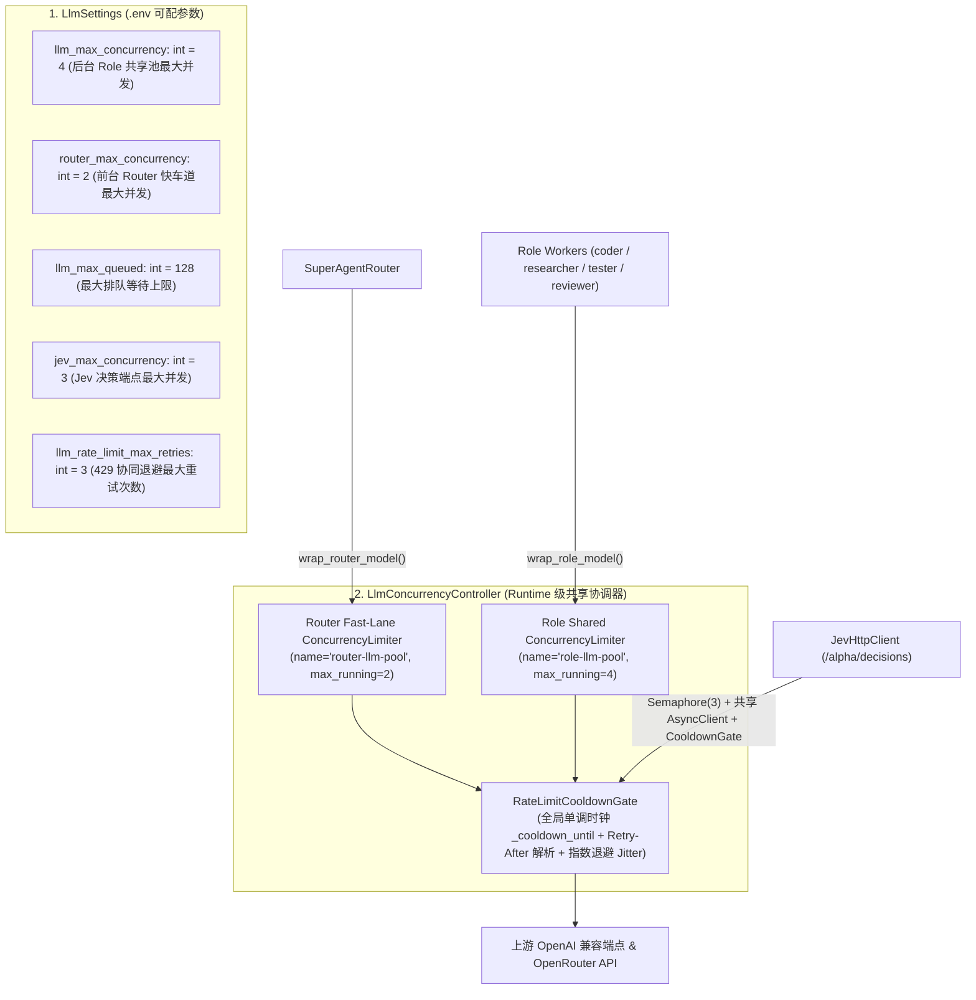

# 并发任务下 LLM 请求限流、双池隔离与 429 协同退避设计规范（Spec）

- **基线 Commit**：`19824fe`（`feat(core): add Step 9.1-9.4 Agent Loop safe exit guards, TaskOutcomeJudge, and 12 E2E tests`）
- **关联计划文档**：[1120-llm-concurrency-limit-plan.md](./1120-llm-concurrency-limit-plan.md)
- **核心目标**：在多 Role 并发执行（共享锁并发调研、跨目录并行编码、工具批量权限复核、前台 Router 即时响应）时，严格控制发往上游 LLM 与 OpenRouter Jev (`/alpha/decisions`) 的同时在途请求数（In-Flight Concurrency），消除 `429 Too Many Requests` 惊群风暴，并保证前台 Router 零饥饿。

---

## 一、 背景与问题边界

1. **工作区锁 $\neq$ LLM 上游并发锁**：
   - `WorkspaceLockManager` 允许同目录多个 `shared` 角色（如多个 `researcher` / `reviewer`）以及不同目录的多个 `exclusive` 角色（如多个 `coder`）同时运行；
   - 当 $N$ 个 Worker 协程同时处于模型推理阶段时，若无进程级/Runtime 级 LLM 并发控制器，会瞬间向上游发送 $N$ 个并发 HTTP 请求，极易触发上游 API Key 的并发数（RPM/TPM/Concurrent Requests）限制。
2. **后台排队阻塞前台（Head-of-Line Blocking）**：
   - 若前台 `SuperAgentRouter` 与后台 Role Workers 共用同一个无差别 FIFO 信号量，当后台 10 个 Role 排满队列时，用户在前台发消息会被后台任务阻塞数十秒。
3. **429 惊群重试风暴（Thundering Herd on 429）**：
   - 当多个并发协程同时收到上游 HTTP `429` 时，若各自独立等待固定时间后同时重试，会再次在同一个时间点撞上 `429`。
4. **`JevHttpClient` 连接与并发失控**：
   - `SemanticBranchRouter`、`PermissionReviewer`、`JevMcpClassifier` 均通过 `JevHttpClient.request_decisions()` 调用 OpenRouter `/alpha/decisions`，此前缺少并发信号量、连接池复用与 `429/503` 退避重试。

---

## 二、 架构设计总览

基于 Pydantic AI (`v2.69.0`) 原生 `ConcurrencyLimiter` 与 `WrapperModel`（`ConcurrencyLimitedModel`），构建 **“双池隔离（Router 快车道 + Role 共享池）+ 全局 429 协同冷却门（CooldownGate）+ Jev 限流重试池”** 架构：



---

## 三、 核心组件详细规范

### 1. 配置扩展（`src/agent/config/settings.py`）
在 `LlmSettings` 新增以下带安全默认值的配置项（支持 `.env` 同名大写环境变量覆盖）：
- `llm_max_concurrency: int = 4`：后台所有 Role Worker 共享的最大同时在途 LLM 请求数；
- `router_max_concurrency: int = 2`：前台 `SuperAgentRouter` 独立保底的最大同时在途请求数（确保后台满载时前台仍能秒回用户）；
- `llm_max_queued: int = 128`：限流器最大排队请求数（防止极端死循环积压内存）；
- `jev_max_concurrency: int = 3`：`/alpha/decisions` 结构化决策端点的最大并发数；
- `llm_rate_limit_max_retries: int = 3`：遇到 HTTP `429`（或 `status_code == 429` 的 `ModelAPIError` / `ModelHTTPError`）时的协同退避最大重试次数；
- `llm_rate_limit_base_delay_sec: float = 0.5`：指数退避基础等待秒数。

---

### 2. 全局 429 协同冷却门（`RateLimitCooldownGate` in `src/agent/llm/rate_limiter.py`）

- **状态维护**：
  - `_cooldown_until: float = 0.0`（基于 `time.monotonic()`）；
  - `_total_waits: int = 0`、`_total_429_hits: int = 0`（供可观测性与单测断言读取）。
- **核心行为**：
  1. `await gate.wait_if_cooling_down()`：
     - 在发出每次真实上游请求前调用；若 `now < _cooldown_until`，则协程休眠 `(_cooldown_until - now)` 秒（若休眠期间其他协程又延长了 `_cooldown_until`，循环对齐到最新冷却结束时刻）。
  2. `gate.notify_rate_limited(attempt: int, *, retry_after_sec: float | None = None) -> float`：
     - 当任意协程捕获到 HTTP `429` 时调用；
     - 若上游提供了 `Retry-After` 秒数，优先采用 `retry_after_sec`；否则计算指数退避 `base_delay * (2 ** attempt)` 并加上 `[0.05, 0.25] * base_delay` 的随机 Jitter；
     - 原子更新 `_cooldown_until = max(_cooldown_until, time.monotonic() + delay)`，使**所有正在排队的其他协程自动感知并暂停发送新请求**，彻底消除并发 429 惊群。

---

### 3. 基于 Pydantic AI `ConcurrencyLimitedModel` 的双池模型包装器（`LlmConcurrencyController`）

在 `src/agent/llm/rate_limiter.py` 实现 `RateLimitedModel(WrapperModel)` 与 `LlmConcurrencyController`：

1. **为什么在 `ConcurrencyLimitedModel` 内层再包一层轻量 `CooldownRetryModel(WrapperModel)`？**
   - 外层使用 Pydantic AI 原生 `ConcurrencyLimitedModel(inner_model, limiter=shared_limiter)` 控制并发槽位（`max_running` 与 `max_queued`）并输出原生 OpenTelemetry 等待指标；
   - 内层 `CooldownRetryModel(WrapperModel)` 在持有并发槽位期间：
     - 请求发出前执行 `await cooldown_gate.wait_if_cooling_down()`；
     - 捕获 `ModelHTTPError(status_code=429)` 或消息含 `429` / `rate limit` 的 `ModelAPIError`，触发 `cooldown_gate.notify_rate_limited(attempt)` 并在槽位内完成退避重试（最多 `max_retries` 次），同时实时追踪 `current_in_flight` 与 `peak_in_flight` 统计指标。
2. **防嵌套死锁与幂等包装**：
   - Pydantic AI 的 `ConcurrencyLimitedModel` 禁止对同一个 `limiter` 嵌套包裹两次（会抛 `UserError`）。
   - `controller.wrap_router_model(model)` 与 `controller.wrap_role_model(model)` 自动检测 `model` 是否已被当前 `controller` 包装：若已包装则幂等原样返回；若用户为某个 `RoleSpec` 传入了独立的 `FunctionModel` 或自定义 `OpenAIChatModel`，在 `RoleSpec.build_agent(model_limiter=...)` 或 `WorkspaceLockManager` 中统一通过 `controller.wrap_role_model()` 纳入全局 Role 限流池！

---

### 4. `JevHttpClient` 并发限流、连接池复用与 429 退避（`src/agent/llm/jev_client.py`）

1. **并发信号量与冷却门**：
   - `JevHttpClient` 新增 `max_concurrency: int = 3`、`max_retries: int = 3`、`base_delay_sec: float = 0.2` 与可选共享 `cooldown_gate: RateLimitCooldownGate | None = None`；
   - 内置 `asyncio.Semaphore(max_concurrency)`，确保任意时刻发往 `/alpha/decisions` 的并发请求数严格 $\le \text{jev\_max\_concurrency}$。
2. **连接池复用与 429/503 自动退避**：
   - 惰性复用内部 `httpx.AsyncClient`（提供 `aclose()` 在 `open_runtime` 退出时优雅关闭），不再每次 `request_decisions` 都新建 TCP/TLS 连接；
   - 当收到 HTTP `429`、`502`、`503`、`504` 时，解析 `Retry-After` 头并通知 `CooldownGate`，执行指数退避重试。

---

## 四、 模块边界与强解耦拓扑

```text
Layer 0（配置与纯限流原语：零 DB、零业务耦合）
├── config/settings.py      # LlmSettings 新增 llm_max_concurrency / router_max_concurrency / jev_max_concurrency 等
└── llm/rate_limiter.py     # RateLimitCooldownGate, CooldownRetryModel, LlmConcurrencyController, ConcurrencyStats

Layer 1（LLM / Jev 客户端层）
├── llm/jev_client.py       # JevHttpClient 接入 Semaphore + 连接池复用 + 429/503 CooldownGate 退避重试
└── core/model.py           # build_model(settings, limiter=...) 支持可选包裹限流器

Layer 2（Runtime、Router 与 Scheduler 装配层）
├── core/roles.py           # RoleSpec.build_agent(..., model_wrapper=...) 将所有 Role 模型统一纳入 Role 共享限流池
├── core/scheduler.py       # WorkspaceLockManager 接收 llm_controller，为每个 Role Worker 绑定 wrap_role_model
└── core/runtime.py         # open_runtime 实例化 LlmConcurrencyController，分别绑定 Router 快车道、Role 共享池与 Jev 客户端
```
