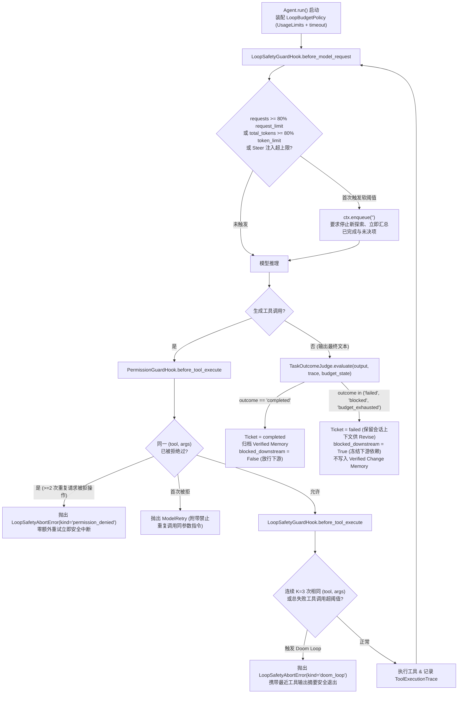

# Agent Loop 安全退出边界（Safe Exit）、双层预算门控与任务成功判定设计规范（Spec）

- **基线 Commit**：`76996c2`（`style: fix ruff UP047 type parameters and clean up lint across src and tests`）
- **关联计划文档**：[1120-loop-safe-exit-plan.md](./1120-loop-safe-exit-plan.md)
- **适用范围**：前台协调器 `SuperAgentRouter` 与后台角色调度器 `WorkspaceLockManager`（`coder`、`reviewer`、`tester`、`researcher` 及自定义 `RoleSpec`）的所有 Pydantic AI Agent Loop。

---

## 一、 背景与核心问题

在多角色异步协同架构中，每个 Agent Loop 的退出路径不仅影响单次任务的 Token 成本与响应延迟，还直接决定**下游依赖任务是否被解锁放行**以及**Memory 系统是否将该次运行沉淀为 `verified_by_tool` 事实**。

对基线 `76996c2` 的审计暴露出四大边界缺口：
1. **最大 Turn / 工具调用与原地死循环（Doom Loop）无防护**：
   - `agent.run()` 未显式绑定角色级 `UsageLimits(request_limit, tool_calls_limit)` 与墙钟 `timeout`；
   - 当模型连续使用完全相同的 `(tool_name, canonical_args)` 反复调用同一工具（如反复读取不存在文件或执行同一报错命令）时，缺少熔断机制，只能空耗到 50 步上限。
2. **Task Success Judge（任务成功判定）缺失导致“伪完成”**：
   - `WorkspaceLockManager._run_worker` 只要拿到 `result.output: str` 且未抛 Python 异常，就无条件将 Ticket 标为 `status="completed"`、`blocked_downstream = False` 并写入成功记忆；
   - 当 Agent 因权限被拒、测试未通过、核心工具失败或预算耗尽而在文本中汇报“无法完成/任务阻塞”时，系统仍误判为成功，**错误解锁下游依赖任务并污染长期记忆**。
3. **Token Budget 缺少硬上限与 80% 软着陆预警（Soft-Limit Wrap-up）**：
   - `total_tokens_limit` / `input_tokens_limit` / `output_tokens_limit` 均为 `None`；
   - 若仅配置硬上限，达到阈值时 Pydantic AI 直接抛 `UsageLimitExceeded` 中断，导致 Agent 已探索出的半成品结论全部丢失，无法输出结构化交接摘要。
4. **Error Interrupt & Max Retry 边界漏洞**：
   - `PermissionGuardHook` 拒绝时抛出 `ModelRetry`，若模型执意重试同一受限调用，会重复打扰审批并在 3 次后触发 `UnexpectedModelBehavior` 崩溃；
   - `SuperAgentRouter` 的主动事件播报 `_run_proactive_report` 与 `WorkspaceLockManager._emit` 缺少异常隔离，一旦播报时 LLM API 抖动，异常会反向击穿 Worker 收尾流程并阻断后续排队任务出队通知。

---

## 二、 架构设计总览



---

## 三、 四大维度详细规范

### 1. 分层运行预算与软硬双阈值（`LoopBudgetPolicy`）

在 `src/agent/core/budget.py`（纯模型与策略层，零 IO）定义统一的 `LoopBudgetPolicy`：

| 参数字段 | 前台 `Router` 默认值 | 后台只读 Role (`researcher`/`reviewer`) | 后台读写 Role (`coder`/`tester`) | 说明 |
| :--- | :---: | :---: | :---: | :--- |
| `max_requests` (`request_limit`) | `12` | `25` | `35` | 单次 `agent.run()` 最大模型请求轮次（Turns） |
| `max_tool_calls` (`tool_calls_limit`) | `20` | `50` | `80` | 单次 `agent.run()` 最大累计工具调用次数 |
| `max_total_tokens` (`total_tokens_limit`) | `60_000` | `150_000` | `240_000` | 单次 `agent.run()` 最大累计 Token 预算 |
| `max_output_tokens` (`output_tokens_limit`) | `16_000` | `32_000` | `48_000` | 单次运行最大累计输出 Token |
| `wall_clock_timeout_sec` (`timeout`) | `90.0` | `300.0` | `600.0` | 单次 `agent.run()` 总墙钟超时秒数 |
| `soft_limit_ratio` | `0.80` | `0.80` | `0.80` | 触发 `<budget_wrapup_warning>` 软着陆提醒的比例阈值 |
| `max_identical_tool_streak` | `3` | `3` | `3` | 连续相同 `(tool_name, canonical_args)` 触发 Doom-Loop 熔断的阈值 |
| `max_steer_injections` | `0` | `10` | `10` | 单次运行最大接收 Steer 注入条数（防外部死循环注入） |
| `max_retries` (`retries`) | `2` | `2` | `3` | Pydantic AI 工具校验/ModelRetry 最大重试次数 |

- **转换方法**：`policy.to_usage_limits() -> UsageLimits` 直接生成 Pydantic AI 原生 `UsageLimits`。
- **80% 软着陆机制（Soft-Limit Wrap-up）**：
  - 当 `ctx.usage.requests >= int(policy.max_requests * policy.soft_limit_ratio)` 或 `ctx.usage.total_tokens >= int(policy.max_total_tokens * policy.soft_limit_ratio)` 或 `ctx.usage.tool_calls >= int(policy.max_tool_calls * policy.soft_limit_ratio)` 时，`LoopSafetyGuardHook.before_model_request` 注入**单次**高优先级指令：
    ```xml
    <budget_wrapup_warning>
    WARNING: You have consumed >=80% of your execution budget (turns/tokens/tool_calls).
    Stop exploratory tool calls immediately. Finalize your current step and output a clear summary of what was completed and any remaining items, ending with `[TASK_STATUS: COMPLETED]` if the mandate is fulfilled or `[TASK_STATUS: INCOMPLETE]` if work remains.
    </budget_wrapup_warning>
    ```

---

### 2. 原地死循环熔断与权限重复拒绝短路（`LoopSafetyGuardHook` & `PermissionGuardHook`）

1. **Doom-Loop（原地踏步死循环）熔断**：
   - `LoopSafetyGuardHook` 在每次 `before_tool_execute` 计算当前调用的规范化指纹 `sig = (call.tool_name, canonical_json(args))`。
   - 若连续 `max_identical_tool_streak`（默认 `3`）次调用的 `sig` 完全一致（且中间没有任何写文件工具改变工作区状态），立即抛出 `LoopSafetyAbortError(kind="doom_loop", tool_name=call.tool_name, streak=3)`（继承自 `AgentRunError`），当场终止 Agent Loop 并记入 `ToolExecutionTrace`。
2. **权限拒绝防重试风暴**：
   - `PermissionGuardHook` 在单次运行内维护 `_denied_signatures: dict[tuple[str, str], str]`（记录已被拒绝的 `(tool_name, canonical_args) -> reason`）。
   - **第 1 次被拒**：记录指纹并抛出 `ModelRetry(f"权限拒绝 [{res.decision_source}]: {res.reason}。严禁使用相同参数再次调用该工具；若无法绕过请直接结束并说明阻塞原因 [TASK_STATUS: BLOCKED]。")`。
   - **第 2 次重复请求同一被拒指纹**：不再弹窗审批、不再给 `ModelRetry` 机会，直接抛出 `LoopSafetyAbortError(kind="permission_denied", ...)` 安全终止，杜绝重复打扰用户与无意义重试风暴。
3. **`TaskSteerHook` 有界限流**：
   - `TaskSteerHook` 增加 `max_injections: int = 10` 参数；当单次运行已消费达到上限时，后续 Steer 指令保留在队列中或记录告警，不在同一次请求内无限注入。

---

### 3. 任务成功判定器（`TaskOutcomeJudge`）

在 `src/agent/core/outcome_judge.py` 实现纯函数/无副作用的 `TaskOutcomeJudge`，在 `agent.run()` 返回后结合 **最终输出文本 (`result.output`)** + **工具执行轨迹 (`ToolExecutionTrace`)** + **预算触发状态 (`LoopSafetyState`)** 进行三维判定：

```python
@dataclass(frozen=True, kw_only=True)
class TaskOutcomeVerdict:
    succeeded: bool
    status: Literal["completed", "failed"]
    reason_code: Literal[
        "verified_success",
        "explicit_status_tag_failed",
        "unresolved_permission_block",
        "unresolved_command_failure",
        "soft_budget_incomplete",
        "empty_output",
    ]
    summary: str
    allow_verified_memory: bool
```

#### 判定规则（优先级从高到低）
1. **显式状态标签优先（Explicit Protocol Tag）**：
   - 若输出包含 `[TASK_STATUS: FAILED]`、`[TASK_STATUS: BLOCKED]` 或 `[TASK_STATUS: INCOMPLETE]` $\rightarrow$ `succeeded=False, status="failed", allow_verified_memory=False`。
   - 若输出包含 `[TASK_STATUS: COMPLETED]` 且无未解决的致命命令失败 $\rightarrow$ `succeeded=True, status="completed", allow_verified_memory=True`。
2. **空白输出拦截**：
   - `not output.strip()` $\rightarrow$ `succeeded=False, reason_code="empty_output"`。
3. **权限阻塞未解拦截（Unresolved Permission Block）**：
   - 若运行轨迹中发生过权限拒绝（`trace.permission_denials > 0`），且后续**没有任何成功的业务工具执行**（`trace.successful_tool_calls == 0`），或输出中明确表述因权限被拒无法完成 $\rightarrow$ `succeeded=False, reason_code="unresolved_permission_block"`。
4. **末端 Shell/测试命令失败未解拦截（Unresolved Command Failure）**：
   - 若在 `tester` 或 `coder` 角色下，最后一次执行的命令工具（`shell` / `run_command`）返回了明确的退出码非零错误（如 `exit code 1`、`FAILED (errors=`、`Command exited with code` 非 0），且之后没有再次成功执行修改或验证命令，同时输出文本未显式声明 `[TASK_STATUS: COMPLETED]` 而是报告失败 $\rightarrow$ `succeeded=False, reason_code="unresolved_command_failure"`。
5. **预算软着陆未完成拦截（Soft-Budget Incomplete）**：
   - 若触发了 80% 软着陆警告（`trace.soft_limit_triggered == True`），且输出表明尚未完成（含未完成关键词或 `[TASK_STATUS: INCOMPLETE]`）$\rightarrow$ `succeeded=False, reason_code="soft_budget_incomplete"`。
6. **口头失败语义兜底检测**：
   - 当 `trace.successful_tool_calls == 0` 且输出匹配典型失败前缀/句式（如 `"无法完成任务"`、`"任务执行失败"`、`"Cannot complete the task"`、`"I was unable to complete"`）$\rightarrow$ `succeeded=False, reason_code="explicit_status_tag_failed"`。

#### 判定为 `succeeded=False` 时的连锁保护
- **Ticket 状态**：更新为 `status="failed"`（保留 `role_conv` 已落盘进度，用户可随时通过 `steer_or_revise_task` 继续）；
- **下游依赖冻结**：`blocked_downstream = True`，严禁解锁依赖该任务的下游排队任务；
- **Memory 防毒化（Provenance Gate）**：**严禁调用 `archive_completed_role_task` 将该次运行记录为 `type="change"` 的成功观察**，避免错误记忆污染工作区。

---

### 4. Error Interrupt 异常隔离与收尾完备性

1. **后台 Worker 异常全覆盖**：
   - `WorkspaceLockManager._run_worker` 捕获：
     - `LoopSafetyAbortError`（细分 `doom_loop` / `permission_denied`，给出清晰的可操作失败原因）；
     - `(AgentRunError, ModelAPIError, UsageLimitExceeded, TimeoutError)`（含 `asyncio.TimeoutError`）；
   - 当因 `UsageLimitExceeded`、`TimeoutError` 或 `LoopSafetyAbortError` 中断时，告知用户具体超限维度（如 `Turn limit 35 exceeded` / `Doom loop on read_file` / `Wall-clock timeout 600s`），引导使用 `steer_or_revise_task` 或拆分任务。
2. **Router 播报与 Scheduler 事件回调异常隔离**：
   - `WorkspaceLockManager._emit()` 使用 `try ... except Exception as exc` 包裹 `await self._on_event(...)`，记录 `logfire.error`，**绝不允许前台播报异常打断 `_release_and_schedule_next` 后续排队任务的唤醒**；
   - `SuperAgentRouter._run_proactive_report()` 與 `handle_user_message()` 绑定 `ROUTER_BUDGET_POLICY`（`max_requests=12`, `timeout=90s`），并对 `_run_proactive_report` 的模型异常做优雅降级（若 LLM 播报失败，直接将原始 `summary` 回退给 `_on_proactive_reply` 或保留在待播报队列，不抛未捕获异常）。

---

## 四、 模块分层与强解耦拓扑

```text
Layer 0（纯策略模型与判定纯函数：零 DB、零网络）
├── core/budget.py          # LoopBudgetPolicy, ROUTER_BUDGET_POLICY, default_role_budget_policy(), LoopSafetyAbortError
└── core/outcome_judge.py   # ToolCallRecord, ToolExecutionTrace, TaskOutcomeVerdict, evaluate_task_outcome()

Layer 1（Pydantic AI Capability Hooks）
├── hooks/loop_safety_hook.py # LoopSafetyGuardHook（80% 软着陆注入、Doom-Loop 连续相同调用熔断、ToolExecutionTrace 采集）
├── hooks/permission_hook.py  # PermissionGuardHook（新增重复被拒调用短路，直接抛 LoopSafetyAbortError）
└── hooks/steer_hook.py       # TaskSteerHook（新增 max_injections 有界保护）

Layer 2（调度器与前台协调器装配）
├── core/roles.py           # RoleSpec 新增 budget_policy: LoopBudgetPolicy | None 字段
├── core/scheduler.py       # 装配 LoopSafetyGuardHook + UsageLimits + timeout + evaluate_task_outcome() + _emit 异常隔离
└── core/router.py          # 装配 ROUTER_BUDGET_POLICY + _run_proactive_report 异常降级回退
```
