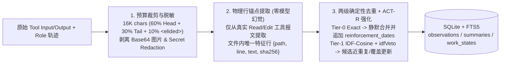
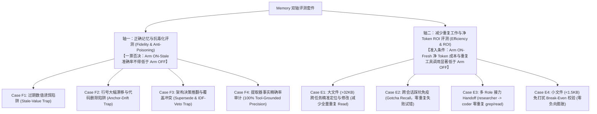

# 同进程分层记忆（L0–L3 渐进披露）、物理锚点防错与双轴评测设计规范

本文定义在现有 `SuperAgentRouter + Role Agents + ContextTreeManager + PermissionGuardHook + ToolExecutionQueueHook` 架构之上，吸收 `claude-mem` 核心设计并裁剪外部进程开销，构建 **零独立 Worker / 零 HTTP CRUD 的同进程分层记忆系统（Memory Subsystem）** 以及 **抗毒化正确性（Fidelity）+ 减少重复工作（ROI）双轴评测体系** 的设计规范。

---

## 一、 设计目标与架构裁剪原则

1. **零独立 Worker 进程、零 HTTP CRUD**：
   - `claude-mem` 因适配外部 CLI 的短命 Shell Hook 进程而不得不引入常驻 Bun HTTP Worker 与磁盘 spool 队列；
   - 本项目所有 Router 与 Role Worker 均运行于同一 Python `asyncio` 进程内，记忆读写直接通过 **`SQLModelMemoryStore`（复用 SQLite `AsyncEngine` + FTS5 全文索引）+ Pydantic AI 原生 `AbstractCapability` 生命周期钩子 + 渐进检索 `MemoryToolset`** 完成，零进程间通信与序列化开销。
2. **错误记忆比没有记忆危害更大（Fidelity First）**：
   - 没有记忆最多多花费一次文件读取或检索的探索 Token；而**过期或错误记忆会直接诱导 Agent 跳过代码核验，输出错误数值或改错代码行**。
   - 架构上必须将 **“结构/因果/踩坑规律（耐久知识）”** 与 **“易变字面值/当前行号（需实时核验）”** 分离：所有关联代码的记忆强制绑定从真实工具报文提取的**物理行锚点（`LineAnchor`）**，读取时当场对照磁盘文件实时重算行号或降级标注 `(code changed since)`。
3. **四级渐进披露（L0–L3）与预算硬约束**：
   - 严禁把全量历史观察塞入 System Prompt；按 **L0 常驻状态 -> L1 紧凑时间线索引 -> L2 文件触发唤醒 -> L3 主动三步深潜** 按需披露，并通过 `ContextBudget` 控制字符与 Token 上限。
4. **可量化评估（Efficiency & Anti-Poisoning）**：
   - 任何记忆注入策略必须同时通过 **抗毒化对抗评测（过期记忆不降低准确率）** 与 **减少重复工作 ROI 评测（净节省探索 Token 与重复工具调用）**。

---

## 二、 写入的 Memory 模型与四类实体

系统**绝不直接存储原始长对话或未裁剪的工具大报文**，而是提炼并持久化以下 4 类高信噪比实体：

### 1. 四类持久化记忆实体

| 实体表 / 类型 | 产生时机 | 核心结构化字段 | 职责与生命周期 |
| :--- | :--- | :--- | :--- |
| **`observations`**<br>（原子观察，核心） | Role 任务关键工具执行后 / 任务收尾提炼 | `id`, `project_key`, `conversation_id`, `role_name`, `type` (`decision` \| `bugfix` \| `feature` \| `refactor` \| `discovery` \| `change`), `title` (≤120字), `subtitle`, `facts_json` (`list[str]`), `narrative`, `concepts_json` (`how-it-works` \| `why-it-exists` \| `what-changed` \| `problem-solution` \| `gotcha` \| `pattern` \| `trade-off`), `files_read_json`, `files_modified_json`, `line_anchors_json`, `file_hashes_json`, `provenance` (`verified_by_tool` \| `user_explicit` \| `agent_inferred`), `discovery_tokens`, `reinforcement_dates_json`, `superseded_by`, `created_at_epoch` | 将耗费数千至数万探索 Token 得出的代码发现、Bug 根因与架构决策浓缩为 ~150 tokens 的结构化卡片，并通过 SQLite **FTS5** 建立全文索引 |
| **`session_summaries`**<br>（任务/阶段总结） | Role 任务完成 (`completed`) 或主会话阶段收尾 | `id`, `project_key`, `conversation_id`, `task_id`, `request`, `investigated`, `learned`, `completed`, `next_steps`, `notes`, `files_read_json`, `files_edited_json`, `discovery_tokens`, `created_at_epoch` | 跨任务/跨会话 Handoff 的宏观脉络；若本轮仅闲聊或无实质产出，支持 `skip_summary` 跳过落库 |
| **`work_states`**<br>（开放状态账本） | 任务进度更新 / 显式状态写入 | `id`, `project_key`, `list_name`, `task_name`, `fields_json`, `status` (`open` \| `in_progress` \| `blocked` \| `done` \| `cancelled`), `created_at_epoch` | 读取时按 `fold_work_state_list()` 顺序折叠：同名 `task_name` 最新字段覆盖旧值，`null` 清除键，`done`/`cancelled` 自动从 L0 隐藏 |
| **`manual_memories`**<br>（显式规则与纠正） | 用户显式纠正 Agent 或调用 `save_memory` | 复用 `observations` 表（标记 `provenance='user_explicit'` 或 `kind='manual'`），带 `revision` 与 `superseded_by` 修订链 | 最高优先级持久知识（如项目专属测试命令、外部 API 特殊契约、禁止事项） |

---

### 2. 写入侧的三道卫生与防膨胀闸门（Write-Time Hygiene）



1. **字段截断与显式省略标记（60/30/10 规则）**：
   - 送入记忆提炼器的单个工具参数或输出上限为 `16,000` 字符（约 4K tokens）：保留前 `60%`（路径、命令头、核心定义）+ 后 `30%`（报错栈尾、最终返回值），中间替换为显式 `<elided chars="..." />` 标记，防止提炼模型对截断区间脑补细节；
   - 自动剥离 Base64 媒体块、`<private>...</private>` 标签内容及匹配的 API Key / Token。
2. **物理行锚点提取（`LineAnchor`，严禁信任 LLM 自报行号）**：
   - 仅从本轮真实执行的 `read_file` / `edit_file` 工具输入与返回中提取每个关联文件最多 `3` 条特征代码行：
     - 特征行必须满足：`8 <= 字母数字长度 <= 400`（排除 `}`、`return` 等无区分度短行及压缩长行）；
     - 该行在当时文件全文中**精确匹配仅出现 1 次，且空白折叠（`squash_whitespace`）后也仅出现 1 次**；
     - 记录 `{path, line, text}` 及当时文件的 `file_sha256`。
3. **两级确定性去重与 ACT-R 记忆强化**：
   - **Tier-0（精确归一化匹配）**：标题与核心代码标识符归一化后完全一致（且非空）→ **不插入新行**，直接在已有记录的 `reinforcement_dates_json` 追加当日 ISO 日期，并合并新增的 `files_read` / `files_modified`；
   - **Tier-1（TF-IDF 余弦 + `idfVeto` 稀有词否决）**：当两标题共享词 $\ge 2$ 且 IDF 加权余弦相似度 $\ge \theta_{\text{cos}}$ 时，检查对称差集中的词是否存在高 IDF 稀有词（如不同函数名、不同错误码）：
     - 若存在稀有区分词 → **触发 `idfVeto` 否决合并**，保留为两条独立观察；
     - 若同文件且新观察修改了旧观察锚定的代码区 → 将旧观察标记 `superseded_by = new_id`。

---

## 三、 四级渐进读取机制：何时读、如何读

### 1. 读取分级总览（L0 – L3）

| 级别 | 名称 | 单次 Token 预算 | 触发时机 | 披露内容 |
| :--- | :--- | :--- | :--- | :--- |
| **L0** | **常驻状态层** | `~300–800 tokens` | 新主会话 / 非 `full_fork` 的 Role Worker 启动 / Compaction 后 | `WorkState` 中仍处于 `open`/`in_progress` 的事项 + 最新 1 条 `SessionSummary` |
| **L1** | **紧凑时间线索引层** | `~15–25 tokens/条`<br>（总上限 `<= 2,500 tokens`） | 同 L0，拼在 L0 之后作为动态 `instructions` 尾部 | 按日期分组的单行表：`#id time icon [type] title @L523`；仅对最新 `K=3` 条展开 `facts` |
| **L2** | **文件/搜索触发层** | `~100–400 tokens/文件` | Agent 调用 `read_file`（文件 $\ge 1.5\text{KB}$）或 `search_files` 时由 Hook 触发 | 该文件的历史观察时间线 + **实时重定位后的 `@L<当前行>` 或 `(code changed since)` 警示**（单会话每文件仅触发 1 次） |
| **L3** | **主动三步深潜层** | 按需（`~300 tokens/条`） | Agent 主动调用 `MemoryToolset` 工具 | `memory_search`（FTS5 索引）→ `memory_timeline`（前后因果邻域）→ `get_observations(ids)`（完整 `facts` + `narrative`） |

---

### 2. 四大读取时机与核心算法细节

#### 时机一：会话 / Role Worker 启动时（L0 + L1 注入）
- **`full_fork` 免重复注入规则**：
  - `ContextTreeManager` 中以 `branch_mode == "full_fork"` 派生的分支已完整携带父分支消息历史，**跳过 L0/L1 注入**，避免双倍消耗 Token 并保持 Prefix Cache 稳定；
  - `root` / `root_only` / `handoff` 及 `WorkspaceLockManager` 启动的独立 Role 任务，按绑定的 `work_path` 加载 L0 + L1。
- **ACT-R 激活度混合排序（保护最新头部 + 唤醒高频强化记忆）**：
  - 候选池拉取最新 $N \times 5$ 条未过期观察（排除已被 `superseded_by` 取代的旧记录）：
    - **最新头部保护（`recency_head_size = ceil(N / 4)`）**：最新 $1/4$ 槽位固定按时间保留，确保刚发生的修改绝不被老记忆挤掉；
    - **其余 $3/4$ 槽位按 ACT-R 激活度打分**：
      $$\text{score}(m) = \ln\left(1 + \text{age}_{\text{created}}^{-d} + \alpha \sum_{t_i \in \text{reinforcements}} \text{age}(t_i)^{-d}\right), \quad d = 0.5$$
      让跨会话被反复印证的核心架构知识与踩坑规律持续留在 L1 窗口内。

#### 时机二：`read_file` / `search_files` 执行时的 L2 文件记忆唤醒与大文件引导
在 `FileMemoryContextHook`（优先级位于 `ToolExecutionQueueHook (20)` 之后、`MCP/Skills (50)` 同层）中拦截 `read_file`：
1. **极小文件免打扰阈值（`FILE_CONTEXT_MIN_BYTES = 1,500`）**：
   - 目标文件 `< 1.5KB` 时不注入文件时间线（直接读全文比附加时间线更省 Token）。
2. **特异性排序 + 会话内单次去重**：
   - 查询关联该规范化路径的观察，按特异性打分（曾修改该文件 `+2`、观察涉及总文件数 $\le 3$ `+2`、$\le 8$ `+1`）取 Top-10，同一 `run_id` / 会话对同一文件仅注入 1 次。
3. **实时行锚点重定位（Real-Time Line Anchor Verification）**：
   - 读取当前磁盘文件构建行索引（精确表 + 空白折叠表），逐条核对观察中的 `LineAnchor`：
     - **`found`（全部锚点在当前文件中仍唯一命中）**：在时间线行尾输出最新行号 **`@L703`**（即使文件前面新增/删除了代码行，也能精准指向当前行！）；
     - **`partly-changed`（部分命中）**：输出 **`@L703 (some code changed since)`**；
     - **`changed`（锚点已消失或出现多处）**：输出 **`(code changed since)`**，并在提示头加粗警告：**`[WARNING: File modified after these observations; verify current code before relying on past facts]`**。
4. **大文件按需引导（`LARGE_FILE_HINT_BYTES = 32 * 1024`）**：
   - 当文件 $\ge 32\text{KB}$ 且存在 `found` 锚点时，在 L2 时间线中明确提示对应符号与最新 `@L` 行号，引导后续使用 `read_file(path, start_line, end_line)` 或 `get_observations([id])` 精准读取，减少整文件重复全量读取。

#### 时机三：Compaction 压缩后恢复
- 当会话发生上下文压缩（Compaction）后，自动重新附带 L0（未关闭的 `WorkState` + 最新 `SessionSummary`），防止长链路执行后遗忘阶段目标与未完事项。

#### 时机四：Role Agent 主动调用 L3 `MemoryToolset`
向 Role Agents 暴露 4 个高内聚工具（`readOnlyHint=True` 的前 3 个在 `PermissionGuardHook` 下为 `pass` + `shared` 并发，`save_memory` 为 `pass` + `exclusive`）：
- `memory_search(query, type?, concepts?, file_path?, limit=15)`：基于 SQLite FTS5 BM25 检索，仅返回紧凑索引行；
- `memory_timeline(anchor_id, depth_before=3, depth_after=3)`：查看锚点观察同会话前后的连续操作时间线；
- `get_observations(ids)`：批量读取选中 ID 的完整 `facts`、`narrative`、`files_modified` 与实时核验后的 `line_anchors` 状态；
- `save_memory(title, facts, type="decision", concepts=..., files=...)`：显式写入高价值架构规律或用户纠正。

---

## 四、 错误记忆防护与双轴评估体系设计（Fidelity & ROI Evaluation）

### 1. 防错误记忆的四道架构红线（Anti-Poisoning Safeguards）

1. **事实与易变字面值解耦**：
   - 提炼 Prompt 明确规定：`Observation` 重点记录**模块职责、调用链路、不变量、Bug 根因与踩坑约束（Gotchas）**；对于业务常量、配额数值、配置阈值等易变字面值，只记录“该值定义在何处（配合 `LineAnchor`）”，不作为免读代码的终极答案。
2. **写穿失效（Write-Through Supersede）**：
   - 当 Role 在本轮成功执行 `edit_file` / `write_file` 修改了文件 $F$ 的某段代码时，自动扫描该文件旧 `Observation` 的 `LineAnchor`：凡旧锚点文本在修改后消失的记录，当场标记 `stale=1` 或关联至本次修改产生的新 `Observation.id`（`superseded_by`）。
3. **未验证推断隔离（Provenance Gate）**：
   - 只有伴随成功工具返回（如测试通过、文件成功读取/编辑、API 返回 200）的结论可标记为 `verified_by_tool`；
   - 工具报错或被 `PermissionGuardHook` 拒绝的尝试，只能提取为 `type="bugfix"` / `concept="gotcha"`（记录“为何失败及如何规避”），严禁记录为已完成状态。
4. **过期记忆零信任降级**：
   - 任何 `LineAnchor` 状态为 `changed` 或文件 `sha256` 失配且无存活锚点的记忆，在注入给模型时强制冠以 `[STALE - CODE CHANGED]` 标签，并在指令头声明：**凡带 `[STALE]` 标记的记忆仅代表历史背景，严禁未经 `read_file` 核实直接引用其中的数值、行号或接口签名**。

---

### 2. 双轴量化评估基准（`Memory Eval Benchmark`）

借鉴 `claude-mem` 的 `tests/evals/read-gate` 双臂对照框架，建立 **Arm OFF（无记忆） vs Arm ON-Fresh（新鲜记忆） vs Arm ON-Stale（过期/冲突诱饵记忆）** 的自动化评测套件，全部采用确定性 Grader（文件/数值断言 + 工具调用轨迹断言）：



#### 轴一：正确记忆与抗毒化评测指标（Fidelity Graders）
1. **`Stale-Value Override Rate`（过期值抗误导率，目标 `100%`）**：
   - 在 `Case F1` 中，种子记忆故意写旧值（如 `min_charge = 22.40 @L523`），而工作区代码实际为 `24.75`。
   - **Pass 条件**：Agent 借助 `@L523` 定位并读取最新代码行，最终回答或基于 `24.75` 修改；若直接输出 `22.40` 则记为 **Poisoned Failure**。
2. **`Anchor Relocation Accuracy`（行锚点漂移重定位准确率，目标 `100%`）**：
   - 在 `Case F2` 中，在目标函数前插入 200 行无关代码或删除目标函数；
   - **Pass 条件**：`verify_line_anchors()` 必须 100% 精确输出新行号 `@L723` 或 `(code changed since)`，**零错误行号猜测**。
3. **`Contradiction Supersede Precision`（冲突决策覆盖准确率，目标 `100%`）**：
   - 在 `Case F3` 中，先后写入相反技术决策（#1 旧方案 vs #2 新方案），以及标题高度相似但核心稀有标识符不同的两条观察；
   - **Pass 条件**：L1/L2 注入中 #2 自动取代 #1；且 `idfVeto` 100% 阻止含有不同稀有标识符的观察被误合并。
4. **`Extraction Groundedness`（写入事实零幻觉率，目标 `100%`）**：
   - 在 `Case F4` 中，审计提炼出的 `files_read`、`files_modified` 与 `line_anchors.text` 是否 100% 存在于真实工具报文与磁盘文件中。

#### 轴二：减少重复工作与 Token ROI 评测指标（Efficiency Graders）
1. **`Redundant Read / Grep Reduction`（重复全量读与重复搜索削减率）**：
   - 统计跨任务/跨 Role 对同一大文件（$\ge 32\text{KB}$）的整文件读取次数与全库 `search_files`/`grep` 次数：
   - 目标：在 `Case E1 / E3` 中，Arm ON-Fresh 相比 Arm OFF 减少 **$\ge 50\%$ 的整文件重复读取**（转为基于 `@L` 锚点的局部读取或直接命中目标文件）。
2. **`Repeated Trial-and-Error Elimination`（重复踩坑试错消除率）**：
   - 在 `Case E2` 中，已记录一条 `gotcha` 观察（如特定接口参数契约或本地命令限制）；
   - 目标：新会话首次调用即遵循该 `gotcha`，失败重试次数从 Arm OFF 的 $\ge 1$ 次降至 **`0` 次**。
3. **`Net Token & Cost Savings`（净 Token 收益率与 Break-Even 门控）**：
   - 记录每次运行的综合 Token 开销：
     $$\text{CostEquivalent} = \text{InputTokens} + 1.25 \times \text{CacheWriteTokens} + 0.1 \times \text{CacheReadTokens} + 5 \times \text{OutputTokens}$$
   - **Break-Even 规则**：对 `< 1.5KB` 小文件（`Case E4`），钩子保持静默，确保 Arm ON 与 Arm OFF 开销差值在 $\pm 2\%$ 以内，绝不发生“为了省 300 tokens 反而注入 800 tokens 时间线”的负优化。

---

## 五、 模块边界与强解耦拓扑（`src/agent/memory/`）

```text
Layer 0（纯模型 / 纯算法 / 端口协议：零 DB、零网络、零 Pydantic AI Runtime）
├── memory/ports.py        # Observation, SessionSummary, WorkStateEntry, LineAnchor, MemoryStorePort, MemoryExtractorPort
├── memory/anchors.py      # extract_line_anchors(), index_file_lines(), verify_line_anchors()（纯函数行锚点提取与实时重定位）
├── memory/dedup.py        # normalize_title(), tfidf_cosine(), idf_veto_fires(), classify_near_duplicate()（Tier-0/1 去重）
├── memory/rank.py         # act_r_blended_score(), rank_by_strength()（ACT-R 强化衰减排序 + recency 头部保护）
└── memory/budget.py       # truncate_field_60_30_10(), fold_work_state_list(), render_l0_l1_context()（预算裁剪与渲染）

Layer 1（持久化与提炼适配器）
├── db/schema.py + models.py       # 新增 observations (含 observations_fts FTS5 虚拟表)、session_summaries、work_states
├── db/memory_store.py             # SQLModelMemoryStore（实现 MemoryStorePort，支持 FTS5 BM25、近重复合并、superseded_by 更新）
└── memory/extractor.py            # RuleAndJevMemoryExtractor（从任务轨迹确定性提取文件/行锚点 + 可选轻量模型提炼 title/facts）

Layer 2（Hook、Toolset 与 Runtime 装配）
├── memory/toolset.py              # build_memory_toolset(): memory_search / memory_timeline / get_observations / save_memory
├── hooks/memory_hook.py           # FileMemoryContextHook (L2 read_file 实时行锚点唤醒 + 写穿失效)
└── core/scheduler.py + runtime.py # Role 启动按非 full_fork 注入 L0+L1，任务完成异步归档 Observation/Summary
```
